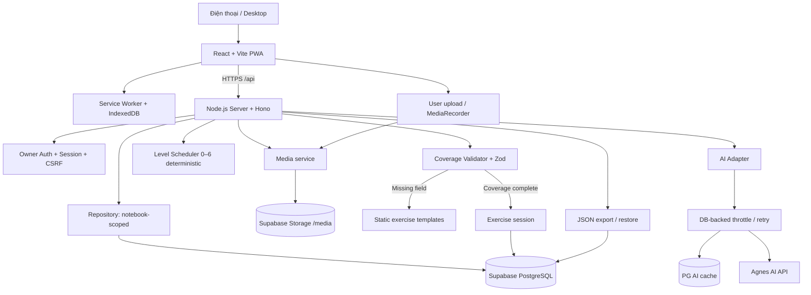
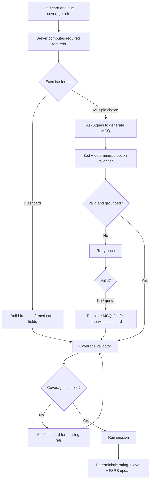

# ARCHITECTURE.md — Ứng dụng học ngoại ngữ cá nhân

> **Trạng thái:** Đã triển khai với Supabase (migration từ Cloudflare Workers + D1).  
> **Ngày tra cứu:** 20/11/2026. **Ngày migrate:** 21/11/2026.  
> **Nguyên tắc:** chi phí hạ tầng mục tiêu 0 USD; TypeScript xuyên suốt; chỉ một chủ sở hữu; AI không quyết định cấp độ thuộc hay lịch ôn; cấp độ thẻ 0–6 và bộ quy tắc deterministic điều khiển tiến/lùi cấp và nhịp ôn; dữ liệu phải xuất/di chuyển được. **Đã chốt:** Hybrid Mastery 0–6 + FSRS-6; giao diện bài tập chỉ có flashcard lật thẻ và trắc nghiệm chọn đáp án. Flashcard dùng tự đánh giá 4 mức theo số lỗi; trắc nghiệm chỉ có Again/Easy theo đúng/sai.

## 1. Tóm tắt khuyến nghị

1. **Stack đề xuất:** React + Vite PWA, Hono API chạy trên Node.js (Supabase PostgreSQL), Supabase Storage cho media (ảnh/âm thanh), IndexedDB cho cache/offline, Zod + Drizzle ORM.
2. **Supabase Free** cung cấp Postgres (1 GB DB), Auth tích hợp, Storage (10 GB free), Edge Functions. Không yêu cầu payment method khi tạo account cơ bản. [4–5] Media upload dùng Supabase Storage bucket `media` thay vì BLOB trong DB — dung lượng gấp 20 lần D1 BLOB.
3. Dùng xác thực chủ sở hữu riêng: bootstrap tài khoản đầu tiên một lần, sau đó khóa endpoint đăng ký; session cookie HttpOnly/Secure/SameSite và mọi API kiểm tra session.
4. Mỗi thẻ có **một cấp độ thuộc 0–6**; cấp độ và kết quả bài tập được cập nhật bằng quy tắc xác định, không do AI tự quyết. Lịch ôn giãn theo cấp độ. Cần duyệt việc thay FSRS-6 bằng Level Scheduler hoặc dùng mô hình lai (xem mục 9.1).
5. Agnes AI chỉ chạy server-side qua adapter OpenAI-compatible; model lấy từ biến môi trường, output luôn qua Zod; AI chỉ sinh câu hỏi trắc nghiệm và nội dung hỗ trợ, không quyết định rating/cấp độ/lịch ôn.
6. Hình ảnh và âm thanh do người dùng cung cấp; không tự sinh ảnh/TTS. Mọi bài tập chỉ trình bày dưới dạng flashcard hoặc trắc nghiệm.
7. Dùng OpenCC WASM với cấu hình Taiwan (`s2twp`/`tw2sp` phù hợp chiều chuyển đổi), không dùng LLM để chuyển Phồn–Giản.
8. **Lợi thế Supabase:** có RLS kiểu Postgres, schema mạnh hơn D1, 10 GB storage miễn phí cho media. Cô lập sổ vẫn enforced qua `notebook_id` trong repository. Offline ưu tiên đọc/ghi hàng đợi cục bộ, đồng bộ khi online.
9. **Lưu ý:** Project Supabase Free có thể bị pause sau 7 ngày ít hoạt động. Cần tương tác ít nhất mỗi tuần để duy trì. Backup định kỳ qua JSON export. [Nguồn 4–5]
10. Stack và các đề xuất nghiệp vụ ở mục 6 cần chủ dự án duyệt trước khi bắt đầu code.

## 2. Chấm điểm và chọn stack

### 2.1 Tiêu chí

Điểm 1–5: 1 = yếu/không phù hợp, 5 = rất phù hợp. Đây là đánh giá kiến trúc cho một người dùng, không phải benchmark tải lớn. Điều kiện **không thẻ + không thể phát sinh phí** là cổng loại: nếu không chứng minh được thì đánh dấu `?`, không coi là đạt tuyệt đối. Ngày tra cứu tất cả lựa chọn: 20/11/2026.

| Lớp / lựa chọn | Free + không thẻ | Quan hệ / ghi review | Auth & cô lập | Media | AI timeout | Cron / ngủ project | Export / backup | Ít lock-in | TS / tài liệu | Đa thiết bị / offline | Kết luận |
|---|---:|---:|---:|---:|---:|---:|---:|---:|---:|---:|---|
| **Supabase Free (Postgres/Auth/Storage)** | 4? | 5 | 5 (RLS) | 5 | 4 (Functions) | 2 (pause inactivity) | 3 | 4 | 5 | 3 | **Chọn** |
| **Cloudflare Workers + D1 (BLOB media)** | 5* | 4 | 4** | 3 | 5 | 4 | 4 | 4 | 5 | 4 | Dự phòng |
| Firebase Spark | 5 | 3 (NoSQL) | 5 | 3 | 2 (Cloud Functions phụ thuộc Blaze) | 4 | 3 | 2 | 5 | 4 | Không chọn |
| Neon Free + Vercel Hobby | 3? | 5 | 2 (tự ghép auth) | 2 | 3 | 3 | 4 | 4 | 5 | 3 | Không chọn |
| Turso/libSQL + hosting khác | 3? | 4 | 2 (tự ghép) | 2 | 3 | 3 | 4 | 4 | 4 | 3 | Không chọn |
| Local-first IndexedDB/SQLite WASM | 5 | 4 | 2 (thiết bị là biên bảo mật) | 3 | 2 (không có server kín để giữ key) | 5 | 4 | 5 | 5 | 5 | Không chọn làm nguồn dữ liệu chính |
| Vercel Hobby + DB riêng | 4? | phụ thuộc DB | phụ thuộc | phụ thuộc | 3 | 3 | phụ thuộc | 3 | 5 | 3 | Không chọn |
| Netlify Free + DB/Blob | 4 | 3 | 3 | 4 | 3 | 3 | 3 | 3 | 4 | 3 | Phương án phụ xa |

`*` Cloudflare cho phép tạo standalone Free account; tài liệu nêu payment method dùng để bật thêm dịch vụ. Workers Free và D1 nằm trong gói Free. Không thêm payment method, không bật add-on usage-based. Nếu một bước bật D1 yêu cầu payment method trong account thực tế thì dừng, không tiếp tục. [17] Workers Free: 100.000 request/ngày, 10 ms CPU/request; thời lượng HTTP không giới hạn cứng khi client còn kết nối; static asset requests miễn phí. [1]

`**` D1 không cung cấp RLS kiểu Postgres. Phân quyền phải được áp dụng nghiêm ngặt trong API/repository và kiểm thử. D1 Free: 10 DB/account, 500 MB/database, tổng 5 GB/account, Time Travel 7 ngày, 50 query subrequests/Worker invocation; `db.batch()` giúp gom nhiều statement trong một query quota. [2]

### 2.2 Lựa chọn chính xác

| Thành phần | Chọn | Lý do / cấu hình |
|---|---|---|
| Frontend | React + Vite + TypeScript | Hệ sinh thái trưởng thành, SPA/PWA nhẹ, không cần SSR cho app cá nhân. |
| API | Hono + TypeScript trên Node.js (Supabase-backed) | Router nhỏ, tương thích Fetch API; Agnes key lưu env var server-side. |
| Hosting | Render/Railway free tier hoặc local dev → Supabase trực tiếp | Tránh phụ thuộc Workers runtime; deploy dễ dàng hơn. |
| Database | **Supabase PostgreSQL** (1 GB free) | Quan hệ notebook → card → review log; mạnh hơn D1 với RLS, foreign keys đầy đủ. |
| Media storage | **Supabase Storage** bucket `media` (10 GB free) | Thay thế D1 BLOB — upload ảnh/audio ra storage, URL lưu trong DB. |
| ORM/migration | Drizzle ORM + drizzle-kit (dialect: postgresql) | Schema TypeScript, migration SQL PostgreSQL-compatible. |
| Auth | Owner-only custom auth trong Postgres | Không phụ thuộc email/SMS provider; bootstrap một lần; PBKDF2 qua Web Crypto, session ký HMAC. |
| Validation | Zod | Validate body, AI JSON, import, cấu hình. |
| UI | React Router + TanStack Query | Route và cache server state rõ ràng. |
| Styling | Tailwind CSS | Responsive nhanh, không ảnh hưởng kiến trúc dữ liệu. |
| Offline | PWA + Service Worker + IndexedDB (Dexie) | Lưu thẻ/queue review gần đây; đồng bộ có kiểm soát. |
| FSRS | `ts-fsrs` v6, chỉ định `FSRS-6` tường minh | Scheduler deterministic; không để model mặc định đổi sang FSRS-7. |
| OpenCC | `opencc-wasm` | OpenCC core/WASM, có cấu hình vùng Taiwan và chạy client-side. [8] |

**Xác thực đăng ký:** lần đầu mở app, nếu bảng `users` chưa có chủ sở hữu, chỉ hiển thị màn hình tạo tài khoản. Transaction/unique constraint bảo đảm chỉ một tài khoản đầu tiên thắng. Sau khi tạo thành công, `POST /api/auth/register` luôn trả 404/403; không có đăng ký công khai. Login yêu cầu mật khẩu; password hash bằng PBKDF2-HMAC-SHA-256 với salt ngẫu nhiên, số vòng lặp cao được benchmark trong Workers; session ID ngẫu nhiên lưu hash trong DB, cookie `HttpOnly; Secure; SameSite=Lax; Path=/`, CSRF token cho thao tác thay đổi dữ liệu, giới hạn login sai. Có nút logout và thu hồi mọi session.

**Không dùng R2 trong stack đã chọn:** dù R2 có free allocation, đây vẫn là sản phẩm usage-based. Cloudflare Billing mô tả payment method cho dịch vụ mua thêm, preauthorization và các khả năng phát sinh phí theo usage. Để giữ điều kiện “không thẻ, không phát sinh hóa đơn”, MVP lưu media nhỏ trực tiếp vào D1 BLOB và đặt hard cap trong ứng dụng; đổi lại dung lượng media bị giới hạn và cần nén file mạnh. R2 chỉ được xem xét nếu chủ dự án thay đổi điều kiện chi phí.

**Không dùng Cloudflare Access làm auth duy nhất:** Access có thể làm lớp bảo vệ phụ nhưng vẫn cần xác thực ứng dụng, kiểm soát notebook và session nội bộ. Tránh khóa chặt dữ liệu vào Access. Email OTP của Access có thể là tiện ích phụ, không phải phụ thuộc bắt buộc. [9]

### 2.3 Vì sao không chọn các lựa chọn khác

- **Supabase:** mạnh nhất về quan hệ và RLS, Auth/Storage tích hợp. Nhưng Free có 500 MB DB, 5 GB egress, không có backup tự động/PITR, project ít hoạt động có thể bị pause sau 7 ngày. [4–5] Điều này xung đột với app học cá nhân có thể có tuần nghỉ. Supabase là phương án dự phòng tốt nếu chủ dự án ưu tiên Postgres/RLS hơn việc không pause.
- **Firebase:** Spark không yêu cầu payment method và có hạn mức miễn phí, nhưng Firestore là NoSQL; quan hệ thẻ/review log và truy vấn thống kê phức tạp hơn. Cloud Functions/Cloud Storage có các giới hạn gói và một số khả năng cần Blaze. [6]
- **Vercel Hobby:** miễn phí cho personal projects, nhưng không cung cấp DB/media quan hệ đầy đủ; cần thêm nhà cung cấp. Tách nhiều vendor làm tăng bề mặt rủi ro quota. [7]
- **Local-first thuần:** offline tốt nhất nhưng không giữ được secret Agnes an toàn nếu không có backend. Không đáp ứng yêu cầu chặn route AI và đồng bộ máy tính/điện thoại một cách đáng tin.
- **Netlify:** Free có 300 credits/tháng và hard limit, nhưng database/blob/compute đều tiêu credits; phù hợp thử nghiệm, ít hấp dẫn hơn D1 cho ghi review thường xuyên. [10]

### 2.4 Các nguồn chính thức stack

1. Cloudflare Workers limits/pricing: https://developers.cloudflare.com/workers/platform/limits/ và https://developers.cloudflare.com/workers/platform/pricing/ (tra cứu 20/11/2026).
2. D1 limits: https://developers.cloudflare.com/d1/platform/limits/ (tra cứu 20/11/2026).
3. Cloudflare Billing / usage-based pricing: https://developers.cloudflare.com/billing/understand/usage-based-billing/ và https://developers.cloudflare.com/billing/understand/billing-policy/ (tra cứu 20/11/2026).
4. Supabase pricing: https://supabase.com/pricing (tra cứu 20/11/2026).
5. Supabase project pausing: https://supabase.com/docs/guides/platform/free-project-pausing (tra cứu 20/11/2026).
6. Firebase pricing: https://firebase.google.com/pricing và https://firebase.google.com/docs/projects/billing/firebase-pricing-plans (tra cứu 20/11/2026).
7. Vercel Hobby: https://vercel.com/docs/plans/hobby (tra cứu 20/11/2026).
8. OpenCC WASM: https://opencc.js.org/ (tra cứu 20/11/2026).
9. Cloudflare Access OTP: https://developers.cloudflare.com/cloudflare-one/integrations/identity-providers/one-time-pin/ (tra cứu 20/11/2026).
10. Netlify pricing: https://www.netlify.com/pricing/ (tra cứu 20/11/2026).
17. Tạo Cloudflare Free account: https://developers.cloudflare.com/changelog/post/2026-08-04-free-dashboard-button/ (Cloudflare nêu tạo Free account trực tiếp; payment method dùng để bật thêm dịch vụ, tra cứu 20/11/2026).

## 3. Xác minh Agnes AI và media

### 3.1 Bảng xác minh Agnes AI

**Lưu ý nguồn:** Trong lần tra cứu này, không tìm được tài liệu API chính thức có thể đọc đầy đủ tại `agnes-ai.com/doc` hoặc `platform.agnes-ai.com`. Repo `AgnesAI-Labs/AgnesAI-Models` tự mô tả là official gateway/model catalog, được liên kết từ Agnes AI; có thể dùng làm tài liệu do nhà cung cấp công bố, nhưng các chi tiết không có ở đó phải giữ `[uncertain]`. Không coi nguồn cộng đồng là xác nhận chính thức. Không gọi API thật trong giai đoạn nghiên cứu.

| Hạng mục | Giá trị tìm được | Trạng thái / nguồn (20/11/2026) |
|---|---|---|
| API base URL | `https://apihub.agnes-ai.com/v1` | Đã xác nhận trong repo model catalog do AgnesAI-Labs công bố. https://github.com/AgnesAI-Labs/AgnesAI-Models/blob/main/MODEL_CATALOG.md |
| Auth header | `Authorization: Bearer <API_KEY>` | Đã xác nhận trong repo trên. |
| Chat endpoint | `POST /v1/chat/completions` | Đã xác nhận. URL đầy đủ: `https://apihub.agnes-ai.com/v1/chat/completions`. |
| Model `agnes-1.5-flash` | Text generation/chat; tài liệu catalog nêu context reference 256K, max output 64K | Đã có tên/model trong catalog; quyền truy cập và quota theo key vẫn cần xác minh ở account. |
| Model `agnes-2.0-flash` | Chat, reasoning, coding, tool calling, vision; context reference 256K, max output 64K theo catalog cập nhật 30/07 | Đã có tên/model; catalog FAQ cũ ghi 512K, mâu thuẫn giữa tài liệu phiên bản. Dùng 256K như thông tin catalog mới hơn nhưng vẫn cần xác minh tại console. |
| Model `agnes-2.5-flash` | Text + vision, reasoning, tool calling, streaming; context reference 512K, max output 65.5K | Đã có trong catalog công khai; account/key access cần xác minh. |
| Image endpoint | `POST /v1/images/generations` | Đã xác nhận trong catalog và ví dụ. |
| Image models | `agnes-image-2.0-flash`, `agnes-image-2.1-flash` | Đã xác nhận tên và endpoint; việc được cấp quyền miễn phí không được bảo đảm. |
| Video model | `agnes-video-v2.0`, `POST /v1/videos`, query `GET /agnesapi?video_id=...` | Đã xác nhận trong catalog; không cần cho MVP. |
| Audio/TTS/STT | Không tìm thấy model TTS/STT hoặc endpoint audio trong catalog đã đọc | **[uncertain]**; không thiết kế phụ thuộc Agnes TTS. |
| Text RPM Free/default | Public 30 RPM, thực thi tham chiếu 20 RPM | Đã nêu trong catalog, cập nhật 28/06/2026; giới hạn thực tế có thể phụ thuộc account/key. |
| Image RPM Free/default | 1K: 20 actual RPM; 2K: 10; 3K: 1; 4K: 1 | Đã nêu trong catalog; không đồng nghĩa image quota miễn phí vô hạn. |
| Token/day hoặc quota tổng text Free | Không có quota ngày rõ ràng trong nguồn đã đọc; gói Token Plan có quota riêng | **[uncertain]** đối với tài khoản cụ thể. |
| Context length | `agnes-1.5-flash`: 256K; `agnes-2.0-flash`: 256K (catalog 30/07); `agnes-2.5-flash`: 512K | Là reference trong catalog, không phải SLA. |
| Structured output / JSON schema | Không tìm được cam kết rõ về `response_format: json_schema` hoặc JSON mode trong tài liệu đã đọc | **[uncertain]**. Bắt buộc dùng JSON prompt + parser + Zod; không dựa vào JSON mode. |
| Function/tool calling | Catalog nêu tool calling cho 2.0/2.5 | Đã xác nhận ở mức capability; format cụ thể/độ tương thích OpenAI đầy đủ cần test. Không cần dùng tool calling trong MVP. |
| Streaming | Catalog có ví dụ `stream: true` cho chat | Đã xác nhận ở mức ví dụ. |
| System prompt | API tương thích OpenAI và dùng `messages`; vai trò system chưa có tài liệu riêng được đọc | **[uncertain]** chi tiết; cần test ở Giai đoạn 1. Adapter vẫn gửi role `system`, kiểm tra hành vi. |
| Lỗi 429 | Error code doc khuyến nghị exponential backoff cho 429 và lỗi tạm thời | Đã xác nhận cách xử lý; `Retry-After` header có/không **[uncertain]**. |
| Lỗi khác | 400 request, 401 auth, 404 endpoint/model, 429 limit, 500/502/503/520 upstream | Đã xác nhận trong `docs/ERROR_CODES.md`; xử lý theo nhóm. |
| Data retention / training | Không tìm thấy điều khoản rõ ràng cho dữ liệu API có được dùng huấn luyện hay thời hạn lưu | **[uncertain]**; không gửi thông tin định danh/nhạy cảm; nội dung học có thể gửi ra Agnes khi gọi AI. Phải đọc Terms/Privacy trước khi dùng dữ liệu thật. |
| Dùng cho ứng dụng cá nhân | Không tìm thấy điều khoản cấm/cho phép rõ ràng trong tài liệu đã truy xuất | **[uncertain]**; chủ dự án cần xác nhận Terms of Service và quyền API key. |
| CORS / gọi từ trình duyệt | Không cần và không được gọi trực tiếp từ browser | Kiến trúc chủ động chỉ gọi từ server; không phụ thuộc CORS. |

**Nguồn Agnes:**
- Repo nhà cung cấp tự công bố là official: https://github.com/AgnesAI-Labs/AgnesAI-Models (README; truy cập 20/11/2026).
- Model catalog: https://github.com/AgnesAI-Labs/AgnesAI-Models/blob/main/MODEL_CATALOG.md (catalog ghi phiên bản 2026.07.30; truy cập 20/11/2026).
- FAQ: https://github.com/AgnesAI-Labs/AgnesAI-Models/blob/main/docs/FAQ.md (cập nhật ghi 2026-06-28; truy cập 20/11/2026).
- Error codes: https://github.com/AgnesAI-Labs/AgnesAI-Models/blob/main/docs/ERROR_CODES.md (truy cập 20/11/2026).
- Ví dụ chat streaming: https://github.com/AgnesAI-Labs/AgnesAI-Models/blob/main/README.md.

### 3.2 TTS, ghi âm, media

| Phương án | Tiếng Trung Phồn thể `zh-TW` | Giản thể `zh-CN` | Anh Mỹ `en-US` | Chi phí / giới hạn | Quyết định |
|---|---|---|---|---|---|
| Web Speech API `speechSynthesis` | Không dùng cho media thẻ | Không dùng cho media thẻ | Không dùng cho media thẻ | Có sẵn tùy thiết bị nhưng ngoài scope | Không dùng trong MVP |
| Tải audio người dùng | Bất kỳ accent/voice nếu file phù hợp | Tốt nếu người dùng cung cấp | Tốt nếu người dùng cung cấp | Tốn D1 database quota | Hỗ trợ |
| Ghi âm microphone (`MediaRecorder`) | Thu âm giọng người học/nguồn audio ngoài | Như trên | Như trên | Miễn phí API; phụ thuộc quyền microphone và codec | Hỗ trợ |
| Agnes AI TTS | Chưa thấy model/endpoint | Chưa thấy | Chưa thấy | `[uncertain]` | Không phụ thuộc |
| Cloudflare R2 | Lưu file tốt, egress miễn phí | Như trên | Như trên | Có free allocation nhưng là usage-based, có rủi ro payment method/overage | **Không chọn** theo ràng buộc không thẻ/không phát sinh phí |
| Local TTS model WASM | Không dùng trong MVP | Không dùng trong MVP | Không dùng trong MVP | Ngoài scope yêu cầu hiện tại | Không chọn |

Không tích hợp TTS vào luồng học theo yêu cầu cập nhật. Người dùng tự tải file âm thanh hoặc ghi âm; file gốc được lưu dưới dạng media và phát lại đúng nội dung đã nhập.

**Nguồn media theo yêu cầu cập nhật:** ảnh và âm thanh chỉ do người dùng tự tải lên hoặc ghi âm. Không gọi Agnes để tạo ảnh, không dùng TTS để tự điền media, không tự tạo audio. Web Speech API nếu có chỉ được xem là tính năng đọc tạm thời ngoài dữ liệu thẻ, không phải media được lưu; mặc định nên ẩn để tránh hiểu nhầm yêu cầu.

**Media budget nội bộ (đề xuất):**
- Audio upload: tối đa 1.5 MB/file; khuyến nghị mono, 16–24 kHz, Opus/WebM hoặc MP3; thời lượng ví dụ 30 giây cho từ/câu ngắn.
- Ảnh: tối đa 500 KB/file; client resize cạnh dài tối đa 1200 px, chuyển WebP/JPEG chất lượng 0.75–0.82, xóa metadata EXIF trước upload.
- Tổng media cloud budget: cảnh báo 200 MB, ngừng upload mới ở 250 MB để chừa phần dung lượng Postgres cho cards/review logs/indexes. Xóa media phải xóa file trong Storage bucket và metadata trong DB cùng lúc.
- Media URL lưu trong cột `blob_url` của bảng `media`, không nhét base64 vào JSON. Metadata MIME/bytes/checksum/width/height/duration lưu cột riêng. Upload qua server đã xác thực, giới hạn MIME thật bằng magic bytes, UUID media id; tên file sinh tự động (không dùng tên người dùng làm path). Supabase Storage là nguồn cloud chính cho media; IndexedDB giữ cache offline.

**Agnes image generation:** không sử dụng. Ảnh trong thẻ do người dùng tự tải lên; không gọi endpoint tạo ảnh.

## 4. Kiến trúc tổng thể



### 4.1 Luồng request bảo mật

1. Worker nhận request; route `/api/*` kiểm tra session cookie, expiry và owner user id.
2. Route nhận `notebook_id`; repository kiểm tra notebook thuộc owner và **mọi SQL đều có điều kiện `notebook_id = ?`**.
3. Zod validate request trước khi gọi service.
4. AI service kiểm tra cache; nếu cache miss thì throttle theo key/model, gọi Agnes server-side bằng `AGNES_API_KEY`.
5. Output được parse/validate Zod; chỉ dữ liệu hợp lệ mới ghi DB.
6. Trả response; lỗi quota không làm hỏng dữ liệu review hoặc scheduler.

### 4.2 Cấu hình môi trường

Secrets/vars chỉ cấu hình trong Cloudflare Worker environment, không lưu trong repo:

- Secret: `AGNES_API_KEY`.
- Vars: `AGNES_BASE_URL`, `AGNES_MODEL_FAST`, `AGNES_MODEL_REASONING`, `AGNES_MODEL_IMAGE`, `AGNES_TIMEOUT_MS`, `AGNES_MAX_RPM`, `APP_ORIGIN`, `SESSION_TTL_SECONDS`, `FSRS_VERSION`, `FSRS_DESIRED_RETENTION`.
- Model ID là config, không hard-code trong logic. Không commit `.dev.vars`, `.env`, key hay file export có dữ liệu cá nhân.
- Dev/test dùng mock adapter; production mới gắn secret thật. Không gọi Agnes trong giai đoạn thiết kế.

### 4.3 Timeout, queue, throttle

- HTTP-triggered Workers không có giới hạn wall-clock cứng khi client còn kết nối, nhưng CPU Free chỉ 10 ms/invocation; mọi xử lý phải async, không chạy tác vụ CPU nặng. [1]
- Giới hạn Agnes hiện được catalog công bố cho Free/default là 20 actual RPM với text. Thiết kế nội bộ ở **12 request/phút** để có headroom, tối đa 1 request đang chạy; configurable theo account thật.
- D1 bảng `ai_rate_limits` hoặc `ai_jobs` giữ `window_start`, `count`, `next_allowed_at`, `status`, `attempts`, `idempotency_key`; transaction/batch ngăn nhiều tab vượt quota.
- Retry 429: tôn trọng `Retry-After` nếu có; nếu không, exponential backoff 2s, 4s, 8s, jitter, tối đa 3 lần; không retry 400/401. Với 500/502/503/520 retry tối đa 2–3 lần, không lặp vô hạn.
- Client gửi `AbortSignal`; timeout ứng dụng 45 giây mặc định (cấu hình được). Nếu hết thời gian, job trạng thái `retryable/failed`; không tạo review log giả.
- Một người dùng không cần Queue service ở MVP. D1-backed queue là đủ; có thể nâng lên Cloudflare Queues nếu tác vụ batch dài. Không dựa vào Cron để duy trì app hoạt động.
- Khi AI hết quota: hiện thông báo “AI tạm hết lượt”; vẫn học/ôn bằng exercise templates, Web Speech, nội dung đã cache. cấp độ/lịch ôn được cập nhật hoàn toàn bằng quy tắc server deterministic và vẫn ghi review. Nếu AI hết quota, bài tập mẫu vẫn dùng được.

## 5. Schema dữ liệu, quan hệ và phân quyền

### 5.1 Quy ước chung

- IDs: UUID v7/UUID random; timestamp ISO-8601 UTC, timezone học tập lưu riêng trong notebook.
- Mọi bảng dữ liệu học bên dưới đều có `notebook_id NOT NULL`. Khóa ngoại ghép `(notebook_id, card_id)`/`(notebook_id, session_id)` nhằm ngăn tham chiếu chéo sổ.
- SQLite/D1 không có RLS. Không expose SQL trực tiếp từ client. Chỉ Worker truy cập DB qua repository. Mọi hàm repository nhận `ownerId` và `notebookId`; không có hàm `getCard(cardId)` thiếu notebook scope.
- Bật foreign keys; dùng `ON DELETE CASCADE` với child records; thao tác xóa notebook chạy transaction, media objects xóa theo danh sách sau khi đánh dấu xóa.
- JSON fields vẫn validate bằng Zod ở biên; không dùng JSON làm lý do bỏ index cho trường cần lọc.

### 5.2 Các bảng

| Bảng | Trường chính | Ghi chú / ràng buộc |
|---|---|---|
| `users` | `id PK`, `email UNIQUE`, `password_hash`, `password_salt`, `created_at`, `is_owner` | Chỉ 1 owner. Bảng auth không phải bảng dữ liệu học. |
| `sessions` | `id PK`, `user_id FK`, `token_hash UNIQUE`, `created_at`, `expires_at`, `last_seen_at`, `revoked_at` | Chỉ lưu hash token session. |
| `notebooks` | `id PK`, `user_id FK`, `name`, `language_variant`, `timezone`, `created_at`, `updated_at`, `deleted_at` | `language_variant` enum mở: `zh-Hant`, `zh-Hans`, `en-US`; thêm mã BCP-47 sau. |
| `cards` | `id`, `notebook_id`, `card_type`, `knowledge_type`, `source`, `front_text`, `fields_json`, `duplicate_hash`, `created_at`, `updated_at`, `archived_at` | UNIQUE `(notebook_id, duplicate_hash)`; FK notebook. `source`: `manual/ai/import`. `fields_json` lưu synonym/antonym/collocation kèm nghĩa Việt riêng từng item. |
| `media` | `id`, `notebook_id`, `card_id`, `field_path`, `media_type`, `mime`, `byte_size`, `sha256`, `blob_data`, `width`, `height`, `duration_ms`, `created_at` | FK ghép `(notebook_id, card_id)`; `blob_data` là BLOB trong D1, mỗi row dưới 2 MB. |
| `card_progress` | `id`, `notebook_id`, `card_id`, `mastery_level`, `first_studied_at`, `last_review_at`, `next_review_at`, `last_session_score`, `consecutive_passes`, `consecutive_failures`, `schedule_policy_version`, `updated_at` | UNIQUE `(notebook_id, card_id)`; một cấp độ + lịch ôn/card. Nếu duyệt FSRS thì bổ sung/đổi sang `fsrs_cards`. |
| `review_logs` | `id`, `notebook_id`, `card_id`, `exercise_session_id`, `level_before`, `level_after`, `due_before`, `due_after`, `session_score`, `field_scores_json`, `hint_count`, `reviewed_at`, `duration_ms`, `policy_version`, `fsrs_rating` nullable | Append-only; lưu cấp độ trước/sau và bằng chứng chấm. Các cột FSRS chỉ cần nếu chủ dự án chọn FSRS. |
| `exercise_sessions` | `id`, `notebook_id`, `card_id`, `mode`, `started_at`, `completed_at`, `coverage_required_json`, `coverage_completed_json`, `rating`, `error_count`, `score` | Mode `learn/review/test/placement`. |
| `exercises` | `id`, `notebook_id`, `session_id`, `exercise_type` (`flashcard`/`multiple_choice`), `payload_json`, `tested_fields_json`, `source`, `schema_version`, `created_at` | `source=ai/template`; tested fields phải qua validator. |
| `exercise_attempts` | `id`, `notebook_id`, `exercise_id`, `answer_json`, `is_correct`, `error_count`, `self_rating`, `feedback_json`, `attempted_at`, `latency_ms` | Ghi từng lượt trả lời để đánh giá kỹ năng. |
| `ai_cache` | `id`, `notebook_id`, `cache_key`, `task`, `model_id`, `prompt_version`, `response_json`, `created_at`, `expires_at` | UNIQUE `(notebook_id, cache_key)`; không cache dữ liệu nhạy cảm. |
| `skill_profiles` | `id`, `notebook_id`, `skill`, `estimate`, `confidence`, `sample_count`, `accuracy_30d`, `updated_at` | Một dòng/sổ/kỹ năng; confidence 0–1. |
| `fsrs_parameters` | `id`, `notebook_id`, `fsrs_version`, `weights_json`, `desired_retention`, `optimizer_version`, `sample_count`, `trained_at`, `is_active` | Tham số riêng từng sổ; giữ lịch sử version. |
| `import_jobs` | `id`, `notebook_id`, `file_name`, `file_hash`, `format`, `mapping_json`, `total_rows`, `inserted_rows`, `duplicate_rows`, `error_rows`, `status`, `created_at` | Log import và kết quả mapping. |
| `placement_runs` | `id`, `notebook_id`, `started_at`, `completed_at`, `result_json`, `confidence_json` | Bài kiểm tra đầu vào riêng từng sổ. |
| `ai_rate_limits` | `id`, `notebook_id`, `provider`, `model_id`, `window_start`, `request_count`, `next_allowed_at` | Throttle dùng chung nhiều tab. |

**Lưu ý:** `notebook_id` cũng phải có trong bảng AI cache, bài tập, attempt, review, media, profile, FSRS parameters, import log, placement. Không có bảng dữ liệu học dùng chung toàn cục.

### 5.3 `fields_json` và chuẩn dữ liệu thẻ

- JSON schema versioned, ví dụ `cardFields.v1`; mỗi trường có `value`, `media_id` hoặc `items[]` tùy kiểu.
- Không lưu file base64 trong `fields_json`; chỉ lưu ID media.
- Chuẩn hóa string Unicode NFC; giữ nguyên chữ gốc người học nhập; phiên âm không dùng làm khóa chống trùng.
- Dữ liệu AI tạo phải có `provenance: ai`, `review_status: pending`; người dùng xác nhận mới chuyển thành accepted.

### 5.4 Quy tắc cô lập notebook

1. Xác thực owner trước khi nhận `notebook_id`.
2. Kiểm tra `SELECT id FROM notebooks WHERE id=? AND user_id=? AND deleted_at IS NULL`.
3. Tất cả query child luôn lọc `notebook_id=?`; không lấy notebook từ body rồi tin mù quáng.
4. FK ghép bảo đảm child của notebook A không thể trỏ card/session notebook B.
5. Dùng integration tests với 2 notebook giả lập: mọi GET/UPDATE/DELETE/import/export/AI cache đều không đọc/ghi chéo.
6. Mọi cache key chứa notebook id, language variant, prompt version và task; không chia cache nội dung học giữa sổ.

## 6. Đặc tả thẻ và các đề xuất chờ duyệt

### 6.1 Thẻ từ vựng

| Trường | Kiểu | Bắt buộc | Ai điền | Ghi chú |
|---|---|---|---|---|
| Từ ngoại ngữ | string | Có | Người dùng/AI/import | Front chính; ví dụ `apple`, `蘋果`. |
| Phiên âm | string | Không | AI/người dùng | `en-US`: IPA; `zh-Hant/zh-Hans`: Pinyin có dấu thanh; Zhuyin là lựa chọn bổ sung. |
| Từ loại | enum/string | Không | AI/người dùng | Lưu nhãn chuẩn hóa và nhãn hiển thị tiếng Việt. |
| Âm thanh | media ref | Không | Người dùng | Chỉ tải file hoặc ghi âm; không AI/TTS tự sinh. |
| Hình ảnh | media ref | Không | Người dùng | Chỉ upload ảnh do người dùng chọn. |
| Từ đồng nghĩa | object[] | Không | AI/người dùng | Mỗi item gồm từ/cụm, nghĩa tiếng Việt, variant/ngữ cảnh; nghĩa là trường riêng để có thể kiểm tra. |
| Từ trái nghĩa | object[] | Không | AI/người dùng | Mỗi item gồm từ/cụm trái nghĩa và nghĩa tiếng Việt; có thể rỗng nếu không có antonym tự nhiên. |
| Collocations | object[] | Không | AI/người dùng | Mỗi item gồm cụm collocation, nghĩa tiếng Việt, ví dụ và dịch ví dụ nếu có. |
| Câu ví dụ | string[] | Không | AI/người dùng | Mỗi câu phải có bản dịch tiếng Việt. |
| Phiên âm câu ví dụ | string[] | Không | AI/người dùng | Theo ngôn ngữ như trên. |
| Dịch câu ví dụ | string[] | Có khi có câu ví dụ | AI/người dùng | Không cho phép câu ví dụ thiếu bản dịch khi lưu. |
| Âm thanh câu ví dụ | media ref | Không | Người dùng | Upload/ghi âm do người dùng thực hiện. |
| **Nghĩa tiếng Việt** | string[] hoặc object[] | **ĐỀ XUẤT bổ sung, chờ duyệt** | AI/người dùng | Thiếu nghĩa thì không thể học từ theo chiều ngoại ngữ ↔ tiếng Việt. Nên hỗ trợ nhiều nghĩa, ví dụ và ghi chú ngữ cảnh. |
| **Loại kiến thức** | enum | **ĐỀ XUẤT bổ sung, chờ duyệt** | Người dùng/AI/import | `vocab/phrase/collocation/idiom/grammar`; giúp quản lý cụm từ, thành ngữ và cấu trúc thay vì nhét mọi thứ vào “từ”. |
| **Ghi chú sử dụng** | string | ĐỀ XUẤT | AI/người dùng | Sắc thái, register, lỗi thường gặp. |
| **Biến thể vùng** | string | ĐỀ XUẤT | Notebook mặc định | Ví dụ zh-TW/en-US; tránh AI trả từ khác vùng. |

### 6.2 Thẻ câu

Bộ trường sau là **ĐỀ XUẤT để chủ dự án duyệt**, ngoài các yêu cầu tối thiểu đã chốt:

| Trường | Kiểu | Bắt buộc | Ai điền | Ghi chú |
|---|---|---|---|---|
| Câu ngoại ngữ | string | Có | Người dùng/AI/import | Front chính. |
| Phiên âm câu | string | Không | AI/người dùng | IPA hoặc Pinyin/Zhuyin. |
| Bản dịch tiếng Việt | string | Có | Người dùng/AI/import | Bắt buộc để hiểu và tự kiểm tra. |
| Âm thanh | media ref | Không | Người dùng | Chỉ upload/ghi âm. |
| Ghi chú ngữ pháp | object[] | Không | AI/người dùng | Cấu trúc, chức năng, giải thích ngắn. |
| Từ/cụm trọng tâm | object[] | Không | AI/người dùng | Liên kết thẻ từ khác nếu có. |
| Hình ảnh | media ref | Không | Người dùng | Chỉ upload ảnh do người dùng cung cấp. |
| Ngữ cảnh/chủ đề | string | Không | Người dùng/AI | Hội thoại, du lịch, công việc... |
| Nguồn/câu gốc | string | Không | Người dùng/import | Lưu nguồn nếu cần. |

### 6.3 Phiên âm theo ngôn ngữ

- `en-US`: IPA (General American) làm chuẩn; không trộn IPA Anh-Anh nếu notebook là en-US.
- `zh-Hant` và `zh-Hans`: Pinyin có dấu thanh làm mặc định chung để dễ tìm kiếm và tương thích công cụ; Zhuyin/Bopomofo là trường phiên âm bổ sung có thể bật riêng cho zh-Hant. Không tự động coi Zhuyin là thay thế Pinyin trong dữ liệu gốc.
- Câu ví dụ luôn có bản dịch tiếng Việt. Nếu AI không chắc phiên âm, để trống và gắn trạng thái cần kiểm tra, không tự bịa.
- Chuyển Phồn/Giản bằng OpenCC config vùng Taiwan, ví dụ `s2twp` cho Simplified → Traditional Taiwan và cấu hình tương ứng `tw2sp`/`t2sp` cho chiều ngược. OpenCC là chuyển đổi từ điển theo cụm, không phải phép thay thế ký tự 1:1. Một chữ giản thể có thể ánh xạ nhiều chữ phồn thể tùy ngữ cảnh; cần giữ nguyên bản gốc, hiển thị bản chuyển đổi như gợi ý, không ghi đè âm thầm. Nguồn: https://opencc.js.org/ (20/11/2026).

### 6.4 AI tự điền trường trống

1. Người dùng nhập front + language variant + loại thẻ.
2. Server lấy schema thẻ và danh sách field rỗng; chỉ gửi nội dung cần thiết đến Agnes.
3. Prompt yêu cầu chỉ điền trường trống, không sửa trường người dùng đã nhập; mọi ví dụ phải có dịch tiếng Việt; variant phải khớp notebook.
4. Output JSON qua Zod; trường không hợp lệ bị loại và yêu cầu sửa lại tối đa một lần.
5. UI hiển thị từng field ở trạng thái `AI đề xuất`; người dùng xem/sửa/chấp nhận. Chưa accept thì chưa lưu thành nội dung chuẩn.
6. Nếu AI lỗi/quota: lưu bản nháp thủ công; không block việc tạo thẻ.

## 7. Bốn chỉ số màn hình sổ và logic phân nhóm

### 7.1 Mô hình cấp độ thuộc 0–6 (đề xuất cập nhật theo yêu cầu mới)

Mỗi thẻ có đúng một `mastery_level` integer từ 0 đến 6. Đây là trạng thái tiến độ của thẻ, không phải nhãn do LLM tự suy đoán:

| Cấp | Nhãn hiển thị đề xuất | Ý nghĩa vận hành |
|---:|---|---|
| 0 | Chưa thuộc | Chưa có lượt học/ôn đạt chuẩn; ưu tiên học mới và nhắc lại thường xuyên. |
| 1 | Mới làm quen | Đã nhận diện được một phần nhưng còn cần gợi ý; ôn dày. |
| 2 | Đang ghi nhớ | Đã nhớ được các trường cốt lõi nhưng độ ổn định chưa cao. |
| 3 | Ghi nhớ cơ bản | Đạt phần lớn yêu cầu; bắt đầu giãn lịch. |
| 4 | Khá vững | Kết quả ổn định trên nhiều dạng bài; ôn thưa hơn. |
| 5 | Rất vững | Khả năng nhớ tốt, ít lỗi ở các trường trọng yếu. |
| 6 | Đã thuộc | Đạt chuẩn duy trì; chỉ cần ôn nhắc lại định kỳ. |

Tên nhãn là đề xuất UX; giá trị cấp số là dữ liệu chính. Không gọi cấp 6 là “vĩnh viễn nhớ”: nếu người học quên, cấp vẫn có thể tụt.

### 7.2 Quy tắc tăng/giảm cấp deterministic

> **Cập nhật theo yêu cầu mới:** các ngưỡng score 85/70 và chấm bài tự do bên dưới không còn là cơ chế tương tác. Rating hiện được xác định theo flashcard/MCQ tại mục 9.3. Cần duyệt bảng ánh xạ rating → thay đổi level; không dùng các ngưỡng score cũ để triển khai.


- AI chỉ có thể chấm câu trả lời tự do và trả về `score`, `correctness`, `evidence`, `confidence`; AI không được gửi `mastery_level`, không được cập nhật cấp, không được chọn ngày ôn.
- Server xác định kết quả từng câu bằng đáp án chuẩn/rubric; câu trắc nghiệm, ghép nối, điền khuyết có thể chấm bằng code. Câu tự do dùng AI hỗ trợ chấm nhưng phải qua schema và ngưỡng confidence; confidence thấp thì đánh dấu cần người dùng tự xác nhận hoặc chấm theo rubric an toàn.
- Mỗi phiên ôn tạo `session_score` theo nhóm trường đã kiểm tra. Dùng **điểm yếu nhất trong các nhóm trường trọng yếu** để tránh điểm tổng cao che mất việc không nhớ nghĩa/phiên âm/nghe. Các trường không có dữ liệu trên thẻ không tham gia tính điểm.
- Ngưỡng tăng cấp đề xuất: coverage bắt buộc hoàn tất, điểm phiên ≥85/100, không sai trường trọng yếu, không dùng hint đáp án; khi đạt thì `level = min(level + 1, 6)`.
- Ngưỡng giữ cấp đề xuất: điểm 70–84 hoặc có dùng hint; giữ nguyên cấp, đặt lịch ôn ngắn hơn trong cùng dải cấp.
- Ngưỡng giảm cấp đề xuất: điểm <70 hoặc sai trường trọng yếu; `level = max(level - 1, 0)` và đưa thẻ vào hàng ôn sớm. Nếu lỗi nặng lặp lại, vẫn chỉ giảm tối đa một cấp mỗi phiên để tránh dao động quá mức; ngoại lệ reset về 0 chỉ khi người dùng chủ động chọn “học lại từ đầu”.
- Các ngưỡng 85/70 và quy tắc “không hint” là **đề xuất chờ duyệt**, cần kiểm thử với người dùng trước khi cố định.

### 7.3 Lịch ôn Hybrid: cấp độ giới hạn, FSRS-6 tính lịch cụ thể

**Đã được chủ dự án duyệt: Hybrid.** `mastery_level` 0–6 là lớp chính sách quyết định khung ôn và khối lượng bài tập; FSRS-6 là bộ máy deterministic tính lịch cụ thể bên trong khung đó. Hai thành phần có vai trò riêng, không được nhập nhằng:

- Cấp độ không do AI tự đặt. Server tăng/giữ/giảm cấp theo kết quả phiên ở mục 7.2.
- FSRS-6 nhận review rating đã được server xác định, trạng thái FSRS hiện tại và tham số riêng notebook; trả stability/difficulty/interval/due theo thuật toán.
- Sau khi FSRS trả interval, server áp dụng `level_min_interval` và `level_max_interval` để clamp khoảng ôn vào khung cấp hiện tại. Đây là lớp chính sách sản phẩm đặt bên ngoài FSRS, không sửa công thức FSRS.
- Nếu cấp thay đổi sau review, server áp dụng khung của cấp mới lên interval FSRS vừa tính. Nếu ngày due bị clamp, lưu cả `fsrs_raw_due` và `effective_due` để audit.
- Level 0 là trạng thái mới/chưa ổn định: dùng learning steps ngắn do cấu hình FSRS-6 (ví dụ 10 phút, 1 ngày là giá trị khởi tạo cần kiểm thử); sau lần đánh giá đạt đầu tiên có thể chuyển lên level 1. Không tự coi Level 0 là một lịch dài hạn.

Bảng dưới là **khung interval đề xuất ban đầu**, cần hiệu chỉnh qua dữ liệu sử dụng; đây không phải interval mặc định của FSRS:

| Cấp | Nhãn | Khoảng interval FSRS được phép | Số câu hỏi ôn mục tiêu / thẻ / phiên |
|---:|---|---:|---:|
| 0 | Chưa ổn định | Learning steps; tối đa 1 ngày | 8–12 |
| 1 | Mới làm quen | 10 phút – 2 ngày | 7–10 |
| 2 | Đang ghi nhớ | 1 – 4 ngày | 6–8 |
| 3 | Ghi nhớ cơ bản | 2 – 10 ngày | 5–7 |
| 4 | Khá vững | 4 – 21 ngày | 4–6 |
| 5 | Rất vững | 7 – 45 ngày | 3–5 |
| 6 | Đã thuộc | 14 – 90 ngày | 2–4 |

Các khung cấp có thể chồng lấn có chủ đích để FSRS phản ánh lịch sử thực tế, nhưng cấp cao không được nhận khung ngắn hơn cấp thấp ở cả hai đầu. Giới hạn tối đa 90 ngày là chính sách sản phẩm khởi tạo, không phải giới hạn thuật toán. Nếu FSRS đề xuất interval ngoài khung, clamp về biên gần nhất; lưu raw interval để theo dõi tần suất clamp. Không jitter ngẫu nhiên mặc định vì sẽ làm khó kiểm chứng và có thể phá vỡ khung.

**Giảm số bài tập mà không bỏ quên trường:** mọi trường có dữ liệu được gắn `coverage_priority` (core / secondary) và `last_tested_at`. Mỗi phiên ôn kiểm tra các trường core; trường secondary được xoay vòng theo độ yếu và thời gian chưa kiểm tra. Bộ lập kế hoạch bảo đảm mỗi trường có dữ liệu được kiểm tra ít nhất một lần trong cửa sổ phủ 3 phiên ôn (đề xuất), hoặc sớm hơn nếu có lỗi gần nhất. Level cao giảm số câu mỗi phiên nhưng không được loại bỏ vĩnh viễn trường nào. Nếu số trường có dữ liệu nhiều hơn ngân sách câu hỏi, tăng số câu tối thiểu cần thiết để bảo đảm cửa sổ phủ.

Cần lưu: `mastery_level`, `fsrs_state`, `fsrs_stability`, `fsrs_difficulty`, `fsrs_due`, `fsrs_raw_interval`, `effective_due`, `last_review_at`, `last_session_score`, `consecutive_passes`, `consecutive_failures`, `level_policy_version`, `fsrs_version`, `fsrs_parameters_version`, `tested_fields`, `coverage_window_state`.

### 7.4 Phân nhóm dashboard loại trừ nhau

- **Chưa học:** `mastery_level = 0` và `first_studied_at IS NULL`.
- **Đã thuộc:** `mastery_level = 6`.
- **Đang học:** `mastery_level BETWEEN 1 AND 5`, cộng các thẻ cấp 0 đã bắt đầu học (`first_studied_at IS NOT NULL`).

Nếu muốn cấp 0 đã học vẫn hiển thị trong “đang học”, ba nhóm trên loại trừ nhau và tổng luôn đúng:

`total_cards = unseen_cards + learning_cards + mastered_cards`.

### 7.5 Bốn chỉ số

| Chỉ số | Logic |
|---|---|
| Tổng số thẻ | `COUNT(cards)` trong notebook, loại trừ archived/deleted. |
| Đến hạn ôn | `COUNT(cards)` có `next_review_at <= now`, không tính thẻ chưa học. |
| Đã thuộc | `COUNT(cards)` có `mastery_level = 6`. |
| Đang học | `total - unseen - mastered`; breakdown theo cấp 0–5 có thể hiển thị thêm. |

**Kiểm chứng:** unit test mọi cấp 0–6, tăng cấp ở ngưỡng, giữ cấp, giảm cấp, cấp chặn ở 0/6, thẻ chưa học; property test bảo đảm mỗi thẻ thuộc đúng một nhóm và tổng bằng total.

## 8. Ma trận phủ trường và kiểm soát bài tập bằng code

### 8.1 Hai hình thức bài tập duy nhất

**Scope lock:** toàn bộ ứng dụng chỉ có đúng hai hình thức tương tác học/kiểm tra/ôn tập:

1. **Flashcard (lật thẻ):** mặt trước hiển thị câu hỏi/gợi ý và media người dùng đã nhập; người học tự nhớ câu trả lời rồi lật thẻ để xem đáp án đầy đủ. Sau khi lật, người học chọn đúng một trong bốn mức theo số lỗi đã mắc:
   - **Lại (Again):** sai từ 3 lỗi trở lên.
   - **Khó (Hard):** sai đúng 2 lỗi.
   - **Tốt (Good):** sai đúng 1 lỗi.
   - **Dễ (Easy):** không sai lỗi nào.
   Một “lỗi” được tính là một đơn vị kiến thức/đáp án con được yêu cầu nhớ trong lượt flashcard nhưng người học nhớ sai hoặc không nhớ. UI phải nêu rõ số mục đang kiểm tra trước khi lật để người học tự đếm nhất quán. Việc chọn mức là tự đánh giá của người học; hệ thống không thể xác minh trung thực số lỗi trong flashcard nếu không yêu cầu nhập câu trả lời.
2. **Trắc nghiệm (multiple choice):** AI sinh câu hỏi và các phương án, người học chọn một đáp án. Server so sánh với `correct_option_id`: chọn sai → **Again**; chọn đúng → **Easy**. Không có Hard/Good trong luồng trắc nghiệm theo yêu cầu hiện tại. Mặc định 4 lựa chọn, chỉ một đáp án đúng; nếu nội dung không thể tạo distractor đáng tin cậy thì không phát hành câu hỏi đó, chuyển sang flashcard.

Không có bài nhập văn bản tự do, điền khuyết tự do, kéo-thả, nối cặp, ghi âm/chấm phát âm, tự luận hoặc dạng tương tác thứ ba. Nội dung cloze/sắp xếp từ/ghép nghĩa nếu có chỉ được đóng gói thành **một câu trắc nghiệm chọn đáp án** hoặc một flashcard; không tạo UI riêng.

### 8.2 Ma trận trường → nội dung flashcard/trắc nghiệm

Chỉ kiểm tra field/item có dữ liệu thật. Ảnh và âm thanh chỉ được lấy từ media do người dùng upload/ghi âm. Mỗi trường dưới đây phải có ít nhất một mẫu flashcard và/hoặc câu trắc nghiệm phù hợp:

| Field / kiến thức | Flashcard có thể hiển thị | Trắc nghiệm có thể hỏi |
|---|---|---|
| Từ ngoại ngữ | Nhìn nghĩa/ảnh/nghe audio, nhớ từ | Chọn từ tương ứng với nghĩa, ảnh hoặc audio |
| Nghĩa tiếng Việt | Nhìn từ, nhớ nghĩa | Chọn nghĩa tiếng Việt đúng |
| Phiên âm từ (IPA/Pinyin/Zhuyin) | Nhìn từ, nhớ phiên âm hoặc ngược lại | Chọn phiên âm đúng |
| Từ loại | Nhớ từ loại khi xem từ | Chọn từ loại đúng |
| Hình ảnh | Nhìn ảnh, nhớ từ và nghĩa | Chọn từ/nghĩa khớp ảnh |
| Âm thanh từ | Nghe audio, nhớ từ/ý nghĩa/phiên âm đã học | Nghe audio, chọn từ hoặc nghĩa đúng |
| Từ đồng nghĩa + nghĩa | Nhớ synonym và nghĩa tiếng Việt của từng synonym | Chọn synonym hoặc nghĩa của synonym đúng |
| Từ trái nghĩa + nghĩa | Nhớ antonym và nghĩa tiếng Việt của từng antonym | Chọn antonym hoặc nghĩa của antonym đúng |
| Collocations + nghĩa | Nhớ cụm và nghĩa tiếng Việt | Chọn collocation phù hợp hoặc nghĩa đúng |
| Câu ví dụ | Nhớ câu ví dụ và nội dung nghĩa | Chọn câu ví dụ đúng hoặc bản dịch đúng |
| Phiên âm câu ví dụ | Nhớ/nhận diện IPA, Pinyin hoặc Zhuyin | Chọn phiên âm câu ví dụ chính xác |
| Dịch câu ví dụ | Nhớ bản dịch tiếng Việt | Chọn bản dịch tiếng Việt đúng |
| Âm thanh câu ví dụ | Nghe câu, nhớ câu/ý nghĩa | Nghe audio, chọn câu hoặc bản dịch tương ứng |
| Câu ngoại ngữ (thẻ câu) | Nhớ câu từ gợi ý nghĩa/ảnh/audio | Chọn câu khớp nghĩa hoặc tình huống |
| Phiên âm câu | Nhớ/nhận diện IPA/Pinyin/Zhuyin | Chọn phiên âm câu đúng |
| Dịch câu | Nhớ nghĩa tiếng Việt của câu | Chọn bản dịch đúng |
| Ghi chú ngữ pháp / từ trọng tâm | Nhớ quy tắc hoặc chức năng | Chọn giải thích/cấu trúc đúng |

Danh sách trường bắt buộc phủ được tính theo từng item, không chỉ theo tên field. Ví dụ một thẻ có 4 synonym thì coverage phải ghi nhận các item synonym và nghĩa tương ứng; không được tính field `synonyms` là đã phủ chỉ vì kiểm tra một synonym.

### 8.3 Contract và kiểm tra bài tập bằng code

`exercise_type` chỉ nhận enum `flashcard | multiple_choice`.

- Flashcard schema: `exercise_id`, `exercise_type='flashcard'`, `front_content`, `back_content`, `tested_field_refs[]`, `tested_item_refs[]`, `media_refs[]`, `expected_content_refs[]`, `schema_version`. Sau khi reveal, UI cung cấp đúng bốn rating `Again | Hard | Good | Easy`; backend nhận `self_rating` và `self_reported_error_count` (0, 1, 2, hoặc 3+), kiểm tra mapping nhất quán.
- Multiple-choice schema: `exercise_id`, `exercise_type='multiple_choice'`, `question`, `options[4]`, `correct_option_id`, `explanation_vi`, `tested_field_refs[]`, `tested_item_refs[]`, `media_refs[]`, `schema_version`. Zod kiểm tra đúng 4 option, ID duy nhất, đúng một đáp án đúng, không trùng option, mọi ref thuộc card hiện tại.
- AI chỉ được sinh payload trắc nghiệm; không được sinh rating, mastery level, FSRS rating, stability, difficulty, interval hoặc due date. Với flashcard, nội dung mặt trước/mặt sau được dựng từ dữ liệu thẻ; AI có thể đề xuất cách hỏi nhưng không sửa nội dung gốc đã được người dùng xác nhận.
- Server tự tính `required_item_refs` từ các field có dữ liệu và lịch phủ; không tin `tested_field_refs` AI khai nếu refs không trỏ đúng dữ liệu.
- MCQ được chấm deterministic: đúng → Easy; sai → Again. Flashcard rating được đối chiếu deterministic với số lỗi người học tự khai: 0 → Easy, 1 → Good, 2 → Hard, >=3 → Again. Mâu thuẫn giữa hai giá trị thì reject request và yêu cầu chọn lại.
- Nếu AI sinh MCQ không hợp lệ, thiếu field, có nhiều đáp án đúng hoặc distractor mơ hồ, server yêu cầu sinh lại tối đa một lần; vẫn lỗi/quota thì dùng template MCQ deterministic nếu có đủ đáp án/distractor đáng tin cậy, nếu không dùng flashcard. Không bịa đáp án nhiễu.
- Server hợp nhất coverage từ exercise đã validate. Thiếu coverage thì sinh bù theo item refs; khi hết quota dùng flashcard template. Không cần gọi AI để dựng flashcard từ dữ liệu thẻ.
- Mọi phiên học/ôn/kiểm tra chỉ hoàn tất khi đủ coverage theo ngân sách cấp độ và cửa sổ phủ đã quy định. Level cao giảm số lượt trong phiên, nhưng không bỏ vĩnh viễn trường nào.

### 8.4 Quy trình bảo đảm phủ trường



## 9. Scheduler cấp độ 0–6 / FSRS-6, chấm bài và hồ sơ trình độ

> **Đã chốt Hybrid:** cấp độ 0–6 quyết định khung ôn và ngân sách bài tập; FSRS-6 tính lịch cụ thể trong khung. Rating lấy từ hai định dạng duy nhất: flashcard tự đánh giá theo số lỗi và MCQ đúng/sai.

### 9.1 Scheduler Hybrid đã được duyệt

**Quyết định chủ dự án ngày 20/11/2026: Hybrid.** Cấp độ 0–6 quyết định khung interval và ngân sách bài tập; FSRS-6 điều chỉnh lịch cụ thể trong khung. Đây không phải lựa chọn giữa hai scheduler nữa.

Luồng xác định:

1. Server kiểm tra exercise coverage và tổng hợp kết quả phiên từ đáp án xác định + rubric chấm tự do đã validate.
2. Server áp dụng quy tắc tại mục 7.2 để xác định `mastery_level_before` → `mastery_level_after`; AI không được gửi cấp độ hay due date.
3. Server ánh xạ kết quả thành FSRS Rating bằng rule cố định (Again/Hard/Good/Easy), không lấy rating trực tiếp từ LLM.
4. `ts-fsrs` chạy rõ `FSRS-6`, nhận trạng thái card, rating, review time và weights của notebook; trả stability, difficulty, scheduled interval và due date.
5. Server lấy khung interval theo `mastery_level_after`, clamp interval FSRS vào `[min_interval, max_interval]`, rồi tính `effective_due`. Lưu cả kết quả FSRS thô và due cuối cùng để audit.
6. Khi level tăng/giảm, thay đổi khung áp dụng ngay cho lần lập lịch vừa hoàn tất; không sửa ngược review log cũ.

**Rating mapping khởi tạo (đề xuất chờ kiểm thử):** Again nếu điểm <60 hoặc sai trường core; Hard nếu 60–79; Good nếu 80–94; Easy nếu ≥95, không dùng hint và confidence chấm tự do đạt ngưỡng. Ngưỡng cần được hiệu chỉnh bằng test; server vẫn là nơi ánh xạ.

**Tương thích runtime:** `ts-fsrs` v6 có hỗ trợ FSRS-6 theo tài liệu đã tham chiếu, nhưng tài liệu package nêu Node.js >=24. Cloudflare Workers không phải Node server đầy đủ; Giai đoạn 0 phải spike build/runtime thực tế. Nếu package không tương thích, chọn phiên bản `ts-fsrs` tương thích Workers có hỗ trợ model FSRS-6 hoặc tách adapter scheduler thuần TypeScript đã kiểm chứng; tuyệt đối không âm thầm dùng FSRS-7. Pin package version và kiểm tra golden vectors so với implementation tham chiếu.

Dữ liệu cần lưu gồm `mastery_level`, FSRS `state`, `due`, `stability`, `difficulty`, `elapsed_days`, `scheduled_days`, `reps`, `lapses`, `last_review`, learning steps, `fsrs_version='FSRS-6'`, raw interval/due, effective due, level policy version và snapshot weights. Level và FSRS state là hai chiều dữ liệu độc lập có liên kết qua rule engine.

### 9.2 Một lịch mỗi thẻ hay mỗi trường?

**Khuyến nghị chung: một lịch ôn duy nhất cho mỗi thẻ.** Nếu duyệt FSRS thì một FSRS card/thẻ; nếu duyệt cấp độ thì một `mastery_level` + `next_review_at`/thẻ. Không tạo lịch riêng cho từng trường trong MVP.

Ưu điểm: dữ liệu gọn, không nhân số lịch theo 10–20 field, tránh quá tải review và tránh việc cùng một từ bị xem là nhiều thẻ riêng. Nhược điểm: một trường yếu (ví dụ nghe) có thể bị che bởi khả năng nhận diện mặt chữ tốt.

Giải pháp: giữ một lịch/thẻ nhưng log từng attempt theo `tested_fields`; profile kỹ năng/field weakness riêng. Bài tập ưu tiên trường có độ chính xác thấp. Không tạo lịch riêng cho nghĩa, nghe, phiên âm... trong MVP.

### 9.3 Rating theo hai hình thức bài tập

Không dùng AI chấm câu trả lời tự do vì sản phẩm không có dạng nhập tự do. Rating được xác định như sau:

| Hình thức | Kết quả | FSRS Rating |
|---|---|---|
| Flashcard | Sai >=3 lỗi | Again |
| Flashcard | Sai đúng 2 lỗi | Hard |
| Flashcard | Sai đúng 1 lỗi | Good |
| Flashcard | 0 lỗi | Easy |
| Trắc nghiệm | Chọn sai | Again |
| Trắc nghiệm | Chọn đúng | Easy |

- Flashcard: người học tự đánh giá số lỗi sau khi lật thẻ. UI bắt buộc chọn một trong bốn mức; có thể lưu số lỗi tương ứng để audit. Đây là self-assessment, không phải điểm AI xác minh.
- Trắc nghiệm: server so sánh `selected_option_id` với `correct_option_id`; AI không chấm đáp án. Sai là Again, đúng là Easy, không có Hard/Good.
- Một phiên có thể chứa nhiều flashcard/MCQ; quy tắc tổng hợp rating cấp thẻ khi kết thúc phiên cần được chốt. Phương án an toàn đề xuất: dùng rating tệ nhất trong phiên làm rating FSRS, tránh một câu dễ che lỗi nghiêm trọng ở trường khác. Đây là đề xuất chờ duyệt.
- Cấp độ 0–6 được rule engine cập nhật từ rating/kết quả phiên; FSRS nhận rating cuối cùng và tính lịch. AI không bao giờ ghi trực tiếp rating, level hay due date.

### 9.4 Tối ưu tham số cá nhân

- `@open-spaced-repetition/binding` có pipeline CSV review log → training items → parameter optimization → evaluation; hỗ trợ truyền `modelVersion: 'FSRS-6'`; optimizer đang ở trạng thái beta. [12]
- Tham số riêng từng notebook. Không trộn review logs tiếng Anh và tiếng Trung.
- Chỉ tối ưu khi có tối thiểu 500 review log chất lượng cho một notebook (ngưỡng sản phẩm đề xuất, không phải yêu cầu thuật toán); so sánh validation metric với default weights, chỉ thay nếu tốt hơn và giữ version cũ để rollback.
- Optimizer WASM có thể chạy trong browser hoặc local tooling; không chạy training trong mỗi Worker request. Xuất review logs CSV, optimize ngoài luồng, người dùng xác nhận import weights. Cần kiểm tra khả năng chạy trên browser/Workers và API optimizer thực tế ở spike kỹ thuật.

### 9.5 AI ước lượng trình độ theo kỹ năng

Không dùng HSK/CEFR/TOCFL làm thang chính. Tạo điểm năng lực nội bộ 0–100 theo từng sổ và từng kỹ năng: `reading`, `listening`, `writing`, `speaking`, `vocabulary`, `grammar`.

- Dữ liệu đầu vào: kết quả attempt, tỷ lệ đúng, latency, số lần dùng hint, field tags, stability/retrievability của các card liên quan.
- Ước lượng cập nhật theo cửa sổ 30 ngày và trọng số recency; không dùng lời nhận xét cảm tính của LLM làm dữ liệu.
- Confidence phụ thuộc số mẫu: `<10` low; `10–29` medium; `>=30` high (ngưỡng sản phẩm đề xuất). UI phải hiển thị sample count và confidence.
- AI chỉ giải thích kết quả và đề xuất bài tiếp theo; score/confidence tính từ số liệu bằng code.
- Bài xếp lớp đầu vào: phân bố câu hỏi tăng dần độ khó cho từng kỹ năng, bắt đầu từ câu cơ bản; dừng thích ứng khi có chuỗi sai hoặc đạt trần. Kết quả là baseline nội bộ + confidence, không gán nhãn HSK/CEFR.

## 10. Nhập nội dung và chống trùng

### 10.1 Ba nguồn

1. **AI sinh:** người dùng chọn sổ, trình độ nội bộ hiện tại, chủ đề, số lượng, loại kiến thức; AI tạo candidate; người dùng review trước khi lưu.
2. **Nhập tay:** tất cả field optional trừ front; người dùng có thể lưu draft rồi hoàn thiện.
3. **Import:** CSV/TSV/JSON; đọc preview, nhận diện header, cho mapping cột → field; validate từng dòng; cho xem lỗi và duplicate trước khi commit.

### 10.2 Chống trùng

- `duplicate_hash = SHA-256(notebook_id | language_variant | card_type | normalize(front_text))`.
- Latin: Unicode NFKC, trim, lowercase, collapse whitespace, chuẩn hóa dấu câu cuối câu; không bỏ dấu IPA hoặc nội dung có ý nghĩa.
- Chinese: Unicode NFKC, trim, collapse whitespace; giữ variant của notebook. Có thể hiển thị cảnh báo khi OpenCC tạo ra biến thể tương ứng nhưng không tự merge vì chữ dị thể/ngữ nghĩa vùng có thể khác.
- Nếu trùng: mặc định skip và hiển thị card hiện có; cho phép người dùng chọn merge fields thủ công. Không tự ghi đè nội dung đã review.
- Unique constraint `(notebook_id, duplicate_hash)` là lớp cuối cùng để tránh race condition giữa AI/manual/import.

## 11. AI Tutor: prompt, schema, cache

### 11.1 Adapter

Interface nội bộ có các hàm `complete`, `stream`, `generateImage?`; nhận `task`, `modelConfigKey`, messages, output schema, timeout, abort signal. Implementation Agnes dùng OpenAI-compatible request; các model ID chỉ đọc từ environment config. Không expose raw Agnes response cho frontend.

### 11.2 Prompt hệ thống mẫu

**A. Điền trường thẻ**

> Bạn là trợ giảng ngôn ngữ. Ngôn ngữ đích là {{language_variant}}, giải thích bằng tiếng Việt. Chỉ điền các trường nằm trong `missing_fields`; tuyệt đối không sửa nội dung `existing_fields`. Dùng cách nói tự nhiên đúng biến thể vùng. Mỗi câu ví dụ phải có bản dịch tiếng Việt. Không bịa phiên âm; nếu không chắc, trả `null` và nêu lý do. Chỉ trả JSON theo schema được cung cấp.

**B. Giảng thẻ**

> Giải thích thẻ hiện tại bằng tiếng Việt, theo trình độ ước lượng và kỹ năng yếu của notebook. Bám sát dữ liệu thẻ; phân biệt điều có trong thẻ với kiến thức bổ sung. Không tạo thông tin phiên âm/định nghĩa nếu không chắc. Đưa 1–3 ví dụ ngắn đúng {{language_variant}} và bản dịch tiếng Việt.

**C. Sinh bài tập**

> Tạo bài tập chỉ từ các field refs được cung cấp. Mỗi bài phải khai báo `tested_fields` và `source_field_refs`. Không tuyên bố kiểm tra một trường nếu câu hỏi không thực sự kiểm tra trường đó. Tuân thủ loại bài được phép và variant. Trả JSON, không markdown.

**D. Chấm bài**

> Chấm câu trả lời của người học dựa trên đáp án/rubric được cung cấp. Chấp nhận biến thể đúng về ngữ pháp và ý nghĩa; chỉ rõ lỗi cụ thể, không đánh đồng khác biệt chính tả vùng với sai nghĩa. Trả score, correctness, evidence, feedback tiếng Việt và confidence. Không tự đặt FSRS Rating/interval.

**E. Đề xuất học tiếp**

> Dựa trên số liệu thống kê đã tính sẵn, đề xuất card/field/kỹ năng cần ưu tiên. Không tự tính stability, retrievability, due date hoặc điểm năng lực. Giải thích bằng các số liệu đầu vào.

### 11.3 Schema output và cache

Mọi output dùng Zod schema tương ứng: `CardEnrichmentSchema`, `TutorExplanationSchema`, `ExerciseSetSchema`, `GradeResultSchema`, `StudyRecommendationSchema`. Không lưu response nếu parse fail; tối đa một lần repair bằng AI, sau đó fallback.

Cache key = hash của task + notebook_id + language_variant + card content version + prompt version + schema version + model id. Cache enrichment/exercise templates lâu hơn (ví dụ 30 ngày) nhưng invalidate khi card đổi; grading không cache theo nội dung câu trả lời nếu response phụ thuộc attempt; tutor Q&A có thể cache 7 ngày. Cache là best-effort, không phải nguồn dữ liệu chuẩn.

## 12. Xuất và sao lưu

- Nút **Xuất toàn bộ** tạo JSON versioned chứa notebooks, cards/fields, FSRS states, review logs, exercises/attempts, profiles, parameters, import logs và manifest media.
- Media export thành ZIP riêng hoặc bundle; ghi media id + SHA-256 + MIME trong manifest. Hỗ trợ tải JSON và từng media; không để file quá lớn làm Worker memory spike. Tạo export theo chunk/pagination.
- Restore chạy vào notebook mới hoặc chế độ replace có xác nhận; validate schema version, hash, FK và media checksum; có dry-run preview số record thêm/trùng/lỗi.
- D1 Time Travel Free có 7 ngày theo tài liệu; xem như phục hồi ngắn hạn, **không thay backup do chủ dự án sở hữu**. [2]
- Sao lưu miễn phí: mỗi tuần người dùng tải JSON + media archive về máy tính/ổ cứng cá nhân; giữ ít nhất 2 bản ở hai vị trí. Có nhắc nhở trong app. Không tự động upload backup sang dịch vụ cloud khác để tránh quota/phát sinh phí.
- Có nút export review log CSV tương thích optimizer. Không lưu API key trong export.

## 13. Rủi ro free tier và biện pháp giảm thiểu

| Rủi ro | Tác động | Giảm thiểu |
|---|---|---|
| Supabase pause sau 7 ngày không hoạt động | Database ẩn, app ngừng hoạt động | Tương tác ít nhất mỗi tuần; export backup định kỳ qua JSON; cron nhẹ giả lập activity nếu cần. |
| Postgres 1 GB đầy | Dữ liệu học bị chặn write | Index vừa đủ, archive logs cũ theo chính sách do người dùng duyệt, export trước khi xóa; theo dõi dung lượng. Review logs dạng text nhỏ. |
| Storage 10 GB đầy | Media không upload được | Giới hạn BLOB mỗi row dưới 2 MB; đề xuất audio ≤1.5 MB/file, ảnh ≤500 KB/file, tổng media cloud cảnh báo 200 MB và chặn upload mới 250 MB; nén ở client, dọn orphan. |
| Agnes RPM/quota hoặc 429 | AI không tạo bài mới/giảng bài | Throttle 12 RPM, cache, backoff, template fallback; review và Level Scheduler vẫn chạy. |
| Agnes model/endpoint thay đổi | AI lỗi | Adapter, model env config, smoke tests giai đoạn 1, error mapping; model fallback configurable. |
| Agnes terms/data training chưa xác minh | Rủi ro riêng tư | Không gửi email/tên thật/secret; gửi tối thiểu dữ liệu card; đọc ToS/Privacy trước dữ liệu thật. Một provider dự phòng tùy chọn có thể được đánh giá sau, không thay Agnes mặc định. |
| App offline / xung đột đa thiết bị | Review không đồng bộ | Outbox queue với client-generated UUID; idempotent sync; server là nguồn chuẩn khi conflict; giữ local backup trước merge. |
| FSRS package v6 yêu cầu Node >=24 | Không tương thích runtime | Spike kỹ thuật trước MVP; nếu cần dùng ts-fsrs v5.4.x hoặc package WASM/runtime phù hợp nhưng pin FSRS-6; test golden fixtures. |
| Optimizer beta | API/weights có thể thay đổi | Tách optimizer khỏi luồng review; giữ weights snapshot và version; chỉ tối ưu thủ công. |
| Người dùng chưa có file audio/hình ảnh | Thẻ thiếu media minh họa/phát âm | Cho phép bỏ trống; người dùng bổ sung upload/ghi âm sau. Không tự tạo media. |
| OpenCC không giải quyết mọi ngữ cảnh | Chuyển sai chữ đa nghĩa | Không overwrite original; hiển thị preview; người học xác nhận. |

## 14. Cấu trúc thư mục dự án đề xuất

```text
project/
├─ docs/
│  ├─ ARCHITECTURE.md
│  ├─ DATA-DICTIONARY.md          # có thể tách sau
│  └─ AI-QUALITY-TESTS.md         # có thể tách sau
├─ src/
│  ├─ app/                        # React routes, layouts, providers
│  ├─ components/                 # UI dùng chung
│  ├─ features/
│  │  ├─ notebooks/
│  │  ├─ cards/
│  │  ├─ learning/
│  │  ├─ review/
│  │  ├─ testing/
│  │  ├─ imports/
│  │  ├─ tutor/
│  │  └─ settings/
│  ├─ lib/                        # date, i18n, OpenCC, validation
│  ├─ offline/                    # IndexedDB, outbox, service worker
│  └─ styles/
├─ worker/
│  ├─ index.ts                    # Hono entry
│  ├─ middleware/                 # auth, csrf, rate limit, errors
│  ├─ routes/                     # auth, notebooks, cards, review, AI, media, export
│  ├─ services/                   # FSRS, AI adapter, import, backup
│  ├─ repositories/                # mọi truy vấn có notebook scope
│  └─ schemas/                     # Zod contracts
├─ db/
│  ├─ schema.ts                   # Drizzle schema
│  └─ migrations/                 # SQL migrations
├─ tests/
│  ├─ unit/
│  ├─ integration/
│  ├─ fsrs-fixtures/
│  └─ ai-quality/
├─ public/
│  ├─ manifest.webmanifest
│  └─ icons/
├─ wrangler.toml
├─ vite.config.ts
├─ package.json
└─ tsconfig.json
```

### Thư viện dự kiến

- `react`, `react-dom`, `react-router`, `vite`, `typescript`.
- `hono`, `zod`, `drizzle-orm`, `drizzle-kit`.
- `ts-fsrs` (pin version sau spike; chọn FSRS-6 explicit), `opencc-wasm`.
- `dexie`, `vite-plugin-pwa`.
- `@tanstack/react-query`, `tailwindcss`.
- `papaparse` (CSV/TSV), native JSON parser + Zod; `fflate` hoặc `JSZip` cho export media bundle nếu cần.
- Test: `vitest`, `@testing-library/react`, `playwright` (E2E local).
- Tránh SDK AI nặng nếu Fetch API + adapter mỏng đủ dùng; nếu dùng OpenAI SDK phải kiểm tra tương thích Cloudflare Workers và chỉ server-side.

## 15. Bộ kiểm thử chất lượng AI — Giai đoạn 1

Không gọi API trong giai đoạn thiết kế. Khi chủ dự án duyệt và cung cấp secret qua dashboard, chạy test có kiểm soát. Mỗi ngôn ngữ có ít nhất các nhóm tác vụ:

| Ngôn ngữ | Tác vụ mẫu | Tiêu chí đạt |
|---|---|---|
| `zh-Hant` | Sinh nghĩa + Pinyin + Zhuyin tùy chọn cho `蘋果`, từ loại và ví dụ | Chữ phồn thể Taiwan; không trả giản thể làm nội dung chính; nghĩa đúng; Pinyin có dấu thanh; dịch Việt tự nhiên. |
| `zh-Hant` | Giải thích khác biệt `軟體/软件`, `裡/里` theo ngữ cảnh | Nêu đúng khác biệt vùng/ngữ cảnh; không khẳng định một chữ thay thế được mọi nơi. |
| `zh-Hant` | Sinh collocations và câu ví dụ có dịch Việt | Cụm tự nhiên ở Taiwan; câu đúng; mỗi câu có bản dịch; không bịa collocation hiếm. |
| `zh-Hant` | Nghe/đọc hiểu câu; tạo cloze | Đáp án duy nhất hoặc rubric rõ; tested field refs chính xác. |
| `zh-Hans` | Enrichment cho `软件`, Pinyin, từ loại, ví dụ | Nội dung giản thể; thuật ngữ phổ thông phù hợp Mainland; không tự đổi notebook variant. |
| `zh-Hans` | Chuyển giản thể/phồn thể đối chiếu | AI không được làm conversion chính; test đối chiếu với OpenCC; nếu bất đồng, ghi chú cần review. |
| `zh-Hans` | Chấm bản dịch Việt của câu Trung | Chấp nhận bản dịch đúng nghĩa; chỉ ra lỗi cụ thể, không quá khắt khe với cách diễn đạt tương đương. |
| `en-US` | Enrichment `run into`, `make a decision`, `boyfriend` | IPA General American, từ loại, nghĩa Việt, collocation và ví dụ đúng ngữ cảnh. |
| `en-US` | Phân biệt từ gần nghĩa và antonym | Nêu khác biệt sắc thái; không tạo antonym giả khi không có cặp tự nhiên. |
| `en-US` | Chấm câu viết/dịch | Ngữ pháp đúng, tự nhiên kiểu Mỹ; feedback tiếng Việt; không đòi slang. |
| Cả ba | Structured JSON / invalid JSON / thiếu field / markdown bao ngoài | Parser xử lý; Zod reject đúng; repair tối đa một lần; fallback template chạy được. |
| Cả ba | Hết quota 429 / timeout / 500 | Backoff; thông báo rõ; không mất draft; review FSRS không bị chặn. |
| Cả ba | Exercise coverage | Server phát hiện field thiếu dù AI khai đã phủ; tự yêu cầu bù hoặc dùng template. |
| Cả ba | Prompt injection trong nội dung import | Nội dung thẻ được coi là data, không được phép ghi đè system prompt hoặc yêu cầu lộ secret. |

**Thang chấm chất lượng:** 0–2 điểm mỗi tiêu chí (đúng ngôn ngữ/variant, chính xác, tự nhiên, đủ field, JSON hợp lệ, dịch Việt, không bịa). Mỗi task cần ≥ 10/12 và không có lỗi nghiêm trọng về variant/ý nghĩa. Với dữ liệu ngôn ngữ, người dùng duyệt mẫu trước khi bật auto-enrichment hàng loạt.

## 16. Luồng nghiệp vụ end-to-end

1. **Mở app:** kiểm tra owner đã tồn tại chưa. Chưa có → màn hình tạo tài khoản một lần; có rồi → login.
2. **Tạo/chọn sổ:** chọn `zh-Hant`, `zh-Hans` hoặc `en-US`; tên sổ tùy chỉnh; có thể tạo nhiều sổ, đổi tên, xóa với confirm và hiển thị số thẻ/media sắp xóa.
3. **Dashboard sổ:** 4 chỉ số (total/due/mastered/learning) và nút Học/Ôn tập/Kiểm tra.
4. **Tạo thẻ:** nhập tay, AI enrichment hoặc import; preview field trống, xác nhận; duplicate check.
5. **Học thẻ mới:** AI giảng theo ngữ cảnh; exercise set theo cấp 0–1 phủ toàn bộ nhóm field có dữ liệu; ghi attempt; server xác định cấp và lịch đầu tiên.
6. **Ôn tập:** lấy thẻ đến hạn theo `next_review_at`; cấp cao có ít câu hỏi hơn nhưng coverage các nhóm field được duy trì theo chu kỳ; server chấm và tăng/giữ/giảm cấp deterministic.
7. **Kiểm tra:** lấy mẫu theo kỹ năng/field, không nhất thiết tạo FSRS review log nếu đây là bài test độc lập; ghi exercise attempts để cập nhật skill profile.
8. **Xếp lớp ban đầu:** mỗi notebook có placement run riêng; bài tăng dần theo độ khó và kỹ năng; trả estimate + confidence, không gán nhãn HSK/CEFR.
9. **Xóa sổ:** confirm rõ tên sổ, số thẻ và media; transaction xóa dữ liệu D1, xóa media BLOB trong D1; không ảnh hưởng sổ khác.

## 17. Lộ trình MVP và tiêu chí hoàn thành

### Giai đoạn 0 — Chốt kiến trúc / kiểm chứng rủi ro

- Xác nhận Cloudflare signup/free không yêu cầu thẻ ở tài khoản triển khai; xác nhận không có tính năng tự phát sinh phí.
- Kiểm tra Hono + D1 BLOB + static assets trên Workers Free; xác nhận không cần payment method.
- Chốt dứt điểm Level Scheduler hay FSRS-6 trước khi code; nếu vẫn giữ FSRS-6 thì spike `ts-fsrs` trên Workers runtime.
- Đọc Agnes Terms/Privacy và xác minh quota/model trên console; không gọi API bằng key trong giai đoạn nghiên cứu.
- Tiêu chí: có quyết định stack được duyệt; mọi rủi ro chặn MVP có phương án.

### Giai đoạn 1 — Nền tảng, auth, notebook, schema

- PWA shell, responsive mobile; owner bootstrap một lần; login/logout/session/CSRF.
- D1 schema/migrations, repository notebook-scoped, CRUD notebook, export JSON khung.
- Tiêu chí: đăng ký lần hai bị chặn; request không auth bị 401; cross-notebook integration tests 100% pass; xóa notebook có confirm.

### Giai đoạn 2 — Card CRUD, media, import/export

- Vocabulary/sentence forms; field optional; nghĩa Việt và knowledge type chỉ triển khai sau khi chủ dự án duyệt.
- D1 BLOB upload/record/audio/image; client resize/nén; CSV/TSV/JSON import mapping; duplicate hash.
- Tiêu chí: import 100 dòng test có preview/mapping; duplicate từ 3 nguồn bị phát hiện; media limit/MIME được kiểm tra; export/restore round-trip giữ nguyên dữ liệu và checksum.

### Giai đoạn 3 — Hybrid mastery + FSRS-6

- Cấp 0–6, rule engine tăng/giữ/giảm, FSRS-6 deterministic, clamp interval theo khung level, due queue, review log và dashboard.
- Tiêu chí: golden tests cho FSRS-6 và ranh giới cấp; test clamp min/max từng level; test cấp đổi sau review; không có LLM trong cập nhật cấp/rating/due; property test nhóm card luôn cộng đúng total.

### Giai đoạn 4 — AI adapter + enrichment + tutor

- Agnes adapter, env model config, Zod output, throttle, cache, timeout/backoff, AI fallback.
- AI enrichment và tutor explanation; chỉ lưu nội dung được user accept.
- Tiêu chí: API key không xuất hiện trong bundle/client/log; test mock 400/401/429/500/timeout; AI invalid JSON không làm hỏng card.

### Giai đoạn 5 — Exercise coverage + grading

- Ma trận field, exercise schema, validator, bù field thiếu, static templates, rating mapping.
- Tiêu chí: test fixture cố tình khai coverage sai phải bị server phát hiện; hết quota vẫn hoàn tất session bằng template; chưa đủ coverage không ghi FSRS review.

### Giai đoạn 6 — Placement, skill profile, optimizer, offline

- Placement test, profile theo notebook × skill, confidence; FSRS-6 optimizer offline/manual theo notebook; IndexedDB outbox và sync conflict handling.
- Tiêu chí: confidence thấp khi sample ít; profile không dùng LLM làm nguồn điểm; offline review đồng bộ idempotent, không duplicate review log; restore trên browser khác thành công.

### Giai đoạn 7 — Hardening / phát hành cá nhân

- E2E mobile/desktop, security tests, quota dashboard, export reminder, accessibility, backup drill.
- Tiêu chí: kiểm thử login/session expiry/CSRF/upload; 2 notebook không lẫn dữ liệu; backup restore thành công; chạy 7 ngày không phát sinh phí và không vượt quota free trong workload test.

## 18. Các mục ĐỀ XUẤT chờ chủ dự án duyệt

1. Bổ sung trường **nghĩa tiếng Việt** cho thẻ từ vựng; hỗ trợ nhiều nghĩa.
2. Bổ sung **loại kiến thức** `vocab/phrase/collocation/idiom/grammar`.
3. Bộ trường thẻ câu: ghi chú ngữ pháp, từ/cụm trọng tâm, hình ảnh, ngữ cảnh/chủ đề, nguồn/câu gốc.
4. Quy ước phiên âm: IPA General American cho en-US; Pinyin dấu thanh làm mặc định cho zh-Hant/zh-Hans; Zhuyin tùy chọn cho zh-Hant.
5. Định nghĩa “đã thuộc”: cấp độ 6; cách tăng/giảm cấp và khoảng ôn theo mục 7 là đề xuất chờ duyệt.
6. Tham số profile confidence: 10/30 mẫu; skill score nội bộ 0–100.
7. Mapping điểm sang FSRS Rating và cách kết hợp với level-band clamp: đã chốt kiến trúc Hybrid; ngưỡng điểm cụ thể vẫn cần kiểm thử và duyệt.
8. Media budget: audio tối đa đề xuất 1.5 MB/file, ảnh 500 KB/file; cảnh báo tổng media 200 MB và chặn upload mới ở 250 MB do D1 giới hạn 500 MB/database.
9. Một lịch ôn cho mỗi thẻ; attempt/field logs riêng; cấp 0–6 đặt khung interval và ngân sách câu hỏi, FSRS-6 tính lịch trong khung. Quyết định Hybrid đã được chủ dự án duyệt.
10. Ảnh và âm thanh do người dùng tự upload/ghi âm; không dùng Agnes image generation hoặc TTS trong MVP.

## 19. Ba quyết định quan trọng nhất cần duyệt

1. **Chọn stack:** Cloudflare Workers + D1 (BLOB media) + React/Vite + Hono (khuyến nghị), hay Supabase Free (dự phòng, có nguy cơ pause khi ít hoạt động). Cần xác nhận điều kiện không thẻ và không billing tại bước tạo account.
2. **Chốt cấu trúc dữ liệu:** bổ sung nghĩa tiếng Việt + loại kiến thức; duyệt bộ trường thẻ câu và quy ước IPA/Pinyin/Zhuyin.
3. **Chốt chính sách Hybrid chi tiết:** kiến trúc Hybrid đã được duyệt; còn cần duyệt/kiểm thử các ngưỡng tăng/giữ/giảm, khung interval theo cấp, ngân sách bài tập và cửa sổ phủ trường. Level 6 là nhãn “đã thuộc”; FSRS stability/difficulty chỉ là tín hiệu lập lịch, không thay thế cấp độ.

---

## Phụ lục A — Các tài liệu tham chiếu bổ sung

11. ts-fsrs v6, hỗ trợ FSRS-6 và Node >=24: https://github.com/open-spaced-repetition/ts-fsrs (tra cứu 20/11/2026); hướng dẫn model versions: https://open-spaced-repetition.github.io/ts-fsrs/guide/optimizer/.
12. FSRS Optimizer: review-log CSV → training items → weights + evaluation; hỗ trợ FSRS-6 và đang beta: https://open-spaced-repetition.github.io/ts-fsrs/guide/optimizer/ (tra cứu 20/11/2026).
13. Agnes AI error codes / retry: https://github.com/AgnesAI-Labs/AgnesAI-Models/blob/main/docs/ERROR_CODES.md (tra cứu 20/11/2026).
14. MDN Web Speech API: https://developer.mozilla.org/en-US/docs/Web/API/SpeechSynthesis (tra cứu 20/11/2026).

## Phụ lục B — Những gì chưa thể kết luận

- Điều khoản Agnes về huấn luyện dữ liệu, lưu giữ dữ liệu, và quyền sử dụng trong ứng dụng cá nhân: `[uncertain]` cho tới khi đọc được Terms/Privacy chính thức.
- JSON Schema/response_format cụ thể của Agnes: `[uncertain]`; bắt buộc kiểm thử trước khi dùng.
- Agnes TTS/STT: `[uncertain]`; không coi là tính năng có sẵn.
- Agnes image model có quota free thực tế cho API key hiện tại hay không: `[uncertain]`.
- Điều kiện yêu cầu thẻ thanh toán khi đăng ký Cloudflare tại quốc gia/tài khoản cụ thể: cần xác nhận trực tiếp trong quy trình signup; không có billing method trong kiến trúc đề xuất.
- Khả năng chạy chính xác bản `ts-fsrs` v6 trên Cloudflare Workers runtime: phải spike ở Giai đoạn 0 do tài liệu v6 nêu Node >=24.


## Phụ lục C — Cập nhật yêu cầu cấp độ 0–6 (20/11/2026)

Các thay đổi người dùng vừa xác nhận đã được phản ánh vào mục 6–9 và schema: (1) cấp độ thuộc mỗi thẻ từ 0 đến 6; (2) server deterministic tăng/giữ/giảm cấp dựa trên kết quả bài tập; (3) cấp càng cao thì lịch ôn càng giãn và số câu hỏi trong một phiên càng giảm; (4) ảnh/audio do người dùng tự nhập; (5) ma trận bài tập bao gồm từ/câu, nghĩa, phiên âm/IPA, câu ví dụ và phiên âm/dịch của ví dụ, từ đồng nghĩa/trái nghĩa kèm nghĩa, collocations kèm nghĩa.

**Điểm chưa thể tự quyết thay người dùng:** tài liệu gốc bắt buộc FSRS-6, nhưng mô hình mới yêu cầu lịch ôn do cấp 0–6 chi phối. Mục 9 trình bày rõ hai phương án; khuyến nghị Level Scheduler vì khớp mô tả mới nhất. Cần chủ dự án xác nhận đây là thay đổi yêu cầu chính thức trước khi triển khai.


## Phụ lục D — Quyết định Hybrid được chủ dự án xác nhận (20/11/2026)

Chủ dự án đã chọn: **Hybrid — cấp độ 0–6 quyết định khung ôn, FSRS-6 điều chỉnh lịch cụ thể.** Quyết định này thay thế các đoạn trước đó yêu cầu chọn một trong hai scheduler.

- `mastery_level` là trạng thái mức độ thuộc do rule engine phía server xác định từ kết quả bài tập; AI không trực tiếp quyết định cấp.
- FSRS-6 vẫn là thuật toán deterministic tạo interval/due dựa trên review history, rating và weights theo notebook.
- Interval cuối cùng là FSRS interval được giới hạn bởi min/max interval của level hiện tại; phải lưu cả raw FSRS output và effective schedule để minh bạch.
- Level càng cao thì ngân sách câu hỏi mỗi phiên giảm, nhưng field coverage được duy trì bằng core fields mỗi phiên và xoay vòng secondary fields trong cửa sổ nhiều phiên.
- Còn chờ duyệt/kiểm thử: ngưỡng score cho Again/Hard/Good/Easy; ngưỡng tăng/giữ/giảm level; bảng min/max interval; số câu mỗi level; cửa sổ phủ field; khả năng tương thích package FSRS-6 với Cloudflare Workers.
- Không còn yêu cầu chủ dự án chọn giữa Level Scheduler và FSRS-6.


## Phụ lục E — Quyết định định dạng bài tập và rating (20/11/2026)

Chủ dự án vừa chốt giới hạn giao diện bài tập: **chỉ có flashcard lật thẻ và trắc nghiệm chọn đáp án**. Quyết định này thay thế mọi ví dụ bài tập cũ có thể bị hiểu là nhập tự do, điền khuyết tự do, kéo-thả, ghép nối, nói/ghi âm hoặc tự luận. Các nội dung đó chỉ được biểu diễn lại dưới dạng flashcard hoặc MCQ, không tạo loại tương tác thứ ba.

### Flashcard
- Sau khi lật thẻ, hiển thị bốn nút: `Lại`, `Khó`, `Tốt`, `Dễ`.
- Mapping số lỗi: `>=3 → Again`; `2 → Hard`; `1 → Good`; `0 → Easy`.
- Người học tự đếm lỗi ở các mục kiến thức được hỏi. Hệ thống lưu rating và số lỗi tự khai; không tuyên bố AI đã xác minh số lỗi.

### Trắc nghiệm
- AI sinh câu hỏi có 4 phương án, một đáp án đúng; Zod và validator server kiểm tra schema, refs và đáp án.
- Chọn sai → Again; chọn đúng → Easy. Không sử dụng Hard/Good cho MCQ.
- Nếu MCQ AI sinh không đáng tin cậy hoặc thiếu dữ liệu, fallback sang template MCQ an toàn hoặc flashcard; không tạo distractor bịa.

### Phạm vi phủ trường
Tất cả dữ liệu có mặt trên thẻ vẫn phải được học/ôn/kiểm tra: từ/câu, nghĩa, phiên âm/IPA, ví dụ và phiên âm/dịch ví dụ, synonym/antonym kèm nghĩa, collocations kèm nghĩa, cùng media người dùng nhập. Coverage được theo dõi theo từng item ref; có thể dùng flashcard tích hợp để giảm số lượt ở level cao nhưng không bỏ sót item trong cửa sổ phủ.

### Các quyết định còn cần chủ dự án duyệt
1. **Rating → thay đổi level:** đề xuất khởi điểm để duyệt: Again giảm 1 cấp (không thấp hơn 0); Hard giữ cấp; Good tăng 1 cấp; Easy tăng 1 cấp (không vượt 6). Cần quyết định liệu Good/Easy có tăng cùng mức hay Easy tăng nhanh hơn.
2. **Tổng hợp nhiều câu trong một phiên:** đề xuất dùng rating tệ nhất trong phiên cho FSRS để tránh che lấp lỗ hổng kiến thức; phương án khác là một rating cuối do người học chọn sau toàn phiên.
3. **MCQ đúng/sai quá nhị phân:** theo yêu cầu hiện tại MCQ đúng luôn Easy và sai luôn Again; cần xác nhận đây là chủ đích, vì nó không dùng Hard/Good và có thể làm FSRS cập nhật mạnh hơn so với mức độ thực tế.

Không thay đổi quyết định Hybrid đã được xác nhận: Level 0–6 giới hạn khung ôn/ngân sách câu; FSRS-6 điều chỉnh due cụ thể. Không bắt đầu lập trình cho tới khi các quy tắc level/rating còn mở được duyệt.


## Phụ lục F — Tổng hợp tối đa 10 bài tập thành một kết quả cuối cho mỗi thẻ (20/11/2026)

### F.1. Quy tắc phiên học/ôn
- Mỗi lần học hoặc ôn một thẻ, hệ thống tạo/chọn **từ 1 đến tối đa 10 bài tập** thuộc thẻ đó. Không được vượt 10 bài/thẻ/phiên.
- Mỗi bài tập chỉ thuộc một trong hai dạng đã chốt: flashcard lật thẻ hoặc trắc nghiệm (MCQ).
- Các bài tập trong phiên có thể kiểm tra nhiều trường/item của thẻ. Server lưu từng attempt riêng: `notebook_id`, `card_id`, `exercise_id`, `item_refs`, `exercise_type`, câu trả lời/kết quả, rating thành phần, điểm số thành phần, thời điểm và nguồn tạo bài.
- Khi kết thúc phiên của thẻ, server tổng hợp kết quả của tất cả bài tập đã hoàn thành thuộc thẻ đó, tính **điểm trung bình cuối cùng**, rồi mới xác định một rating tổng kết và cập nhật mastery level + FSRS-6 đúng một lần cho phiên đó. Không cập nhật FSRS sau từng câu lẻ trong cùng phiên.
- Nếu người học thoát giữa chừng, chỉ các bài đã hoàn thành được lưu. Không tự coi bài chưa làm là sai; phiên chưa có bài hoàn thành thì không tạo review event.

### F.2. Chuẩn hóa điểm từng bài (đề xuất triển khai)
Để tính trung bình giữa hai dạng bài có cách chấm khác nhau, chuẩn hóa rating thành thang điểm 0–3:

| Kết quả bài | Rating thành phần | Điểm |
|---|---|---:|
| Flashcard: sai từ 3 lỗi trở lên | Again | 0 |
| Flashcard: sai 2 lỗi | Hard | 1 |
| Flashcard: sai 1 lỗi | Good | 2 |
| Flashcard: không sai lỗi nào | Easy | 3 |
| MCQ: chọn sai | Again | 0 |
| MCQ: chọn đúng | Easy | 3 |

Công thức:

`mean_score = sum(exercise_score) / completed_exercise_count`

Chỉ tính các bài đã hoàn thành. Không làm tròn `mean_score` trước bước phân loại.

### F.3. Chuyển điểm trung bình thành rating tổng kết (ĐÃ ĐƯỢC CHỦ DỰ ÁN DUYỆT)

| Điểm trung bình | Rating tổng kết | Điểm FSRS |
|---:|---|---|
| `[0.00, 0.50)` | Again | 1 |
| `[0.50, 1.50)` | Hard | 2 |
| `[1.50, 2.50)` | Good | 3 |
| `[2.50, 3.00]` | Easy | 4 |

- Các khoảng được định nghĩa dạng nửa kín như bảng để không có điểm rơi vào hai nhóm hoặc không thuộc nhóm nào.
- Rating tổng kết duy nhất của phiên được gửi vào `ts-fsrs` FSRS-6. Không gửi từng rating thành phần thành các review riêng vì sẽ làm một phiên học bị tính thành nhiều lần review của cùng thẻ.
- Ví dụ: 4 bài có điểm `3, 3, 0, 2` → trung bình `2.00` → Good → FSRS rating Good.
- Với MCQ, đúng luôn đóng góp 3 điểm/Easy và sai đóng góp 0 điểm/Again theo quy tắc người dùng đã chốt. Nhiều câu MCQ giúp giảm ảnh hưởng của đoán mò nhưng không loại bỏ hoàn toàn xác suất đoán đúng.

### F.4. Cập nhật cấp độ 0–6
- Sau khi có rating tổng kết, rule engine phía server áp dụng chính sách thay đổi mastery level đã được duyệt. AI không tự đặt level.
- Quy tắc mapping level cụ thể vẫn là quyết định cần duyệt. Đề xuất đang ghi tại Phụ lục E: Again giảm 1; Hard giữ nguyên; Good tăng 1; Easy tăng 1; chặn trong `[0,6]`.
- FSRS-6 nhận đúng một rating tổng kết cho mỗi phiên/thẻ và tạo raw interval/due; Hybrid scheduler tiếp tục áp dụng giới hạn interval theo level hiện tại.
- Lưu snapshot trước/sau phiên: `level_before`, `level_after`, `mean_score`, `final_rating`, `completed_count`, phân bố rating thành phần, `fsrs_state_before/after`, `raw_interval`, `effective_interval`, `due_at`.

### F.5. Giới hạn 10 bài và phủ trường
- Bộ chọn bài tập ưu tiên các item chưa được kiểm tra hoặc có lịch sử sai gần đây, đồng thời tôn trọng ngân sách tối đa 10.
- Nếu một thẻ có hơn 10 item cần kiểm tra, không nhồi quá 10 bài vào một phiên. Lập `coverage_queue` theo item refs và xoay vòng qua các phiên tiếp theo; các trường cốt lõi và item có lỗi gần đây được ưu tiên.
- Một bài flashcard có thể kiểm tra nhiều item liên quan nếu mặt trước/mặt sau vẫn rõ ràng, không nhập nhằng; validator phải ghi đầy đủ tất cả `item_refs` mà bài thực sự kiểm tra. Không được đánh dấu covered cho item chỉ xuất hiện tình cờ trong nội dung.
- Dashboard/tiến trình phủ trường phải phân biệt `covered_this_session` và `covered_in_recent_window`; không tuyên bố đã kiểm tra đầy đủ thẻ nếu còn item trong coverage queue.

### F.6. Trạng thái quyết định
1. **ĐÃ DUYỆT:** tối đa 10 bài tập cho mỗi thẻ trong một phiên; tổng hợp kết quả các bài đã hoàn thành và dùng điểm trung bình cuối cùng.
2. **ĐÃ DUYỆT:** thang điểm chuẩn hóa `Again=0, Hard=1, Good=2, Easy=3` và các ngưỡng ở F.3: `[0,0.50) → Again`; `[0.50,1.50) → Hard`; `[1.50,2.50) → Good`; `[2.50,3.00] → Easy`. Không làm tròn trước khi phân loại.
3. **ĐÃ DUYỆT:** mỗi phiên chỉ tăng tối đa **1 cấp độ**. Nếu rating tổng kết cho phép tăng cấp, `level_after = min(level_before + 1, 6)`; không có trường hợp tăng nhiều cấp trong một phiên. Quy tắc giảm/giữ cấp theo rating vẫn phải được xác định riêng; không tự suy diễn mapping chưa được chủ dự án duyệt.
4. **ĐÃ DUYỆT VỀ CƠ CHẾ:** chỉ tạo một review event FSRS-6 cho mỗi thẻ sau khi kết thúc phiên; không tạo review event riêng cho từng bài tập.
5. **CÒN CHỜ DUYỆT:** mapping đầy đủ từ rating tổng kết (`Again/Hard/Good/Easy`) sang thay đổi level, đặc biệt chính sách giảm/giữ cấp; bảng min/max interval theo level; số bài tập mục tiêu theo level (không vượt 10); cửa sổ phủ trường.

## Phụ lục G — Phê duyệt ngưỡng tổng hợp và giới hạn tăng cấp (20/11/2026)

Chủ dự án đã xác nhận hai quyết định dưới đây. Các nội dung này là yêu cầu đã chốt, không còn là đề xuất:

### G.1. Ngưỡng điểm trung bình → rating tổng kết
- Mỗi bài tập hoàn thành được chuẩn hóa thành điểm từ 0 đến 3 theo F.2.
- `mean_score = sum(exercise_score) / completed_exercise_count`. Chỉ tính bài đã hoàn thành; bài chưa làm không được tính là sai hoặc đưa vào mẫu số.
- Phân loại trên giá trị chưa làm tròn:
  - `[0.00, 0.50)` → Again.
  - `[0.50, 1.50)` → Hard.
  - `[1.50, 2.50)` → Good.
  - `[2.50, 3.00]` → Easy.
- Các khoảng liên tục, không chồng lấn và bao phủ toàn bộ miền điểm hợp lệ `[0,3]`.

### G.2. Tăng cấp tối đa một bậc mỗi phiên
- Sau khi tổng hợp toàn bộ bài tập của thẻ, hệ thống chỉ được tăng tối đa **một cấp** trong phiên đó.
- Điều kiện tăng cấp phải dựa trên rating tổng kết và mapping level đã được chủ dự án phê duyệt; nếu được tăng thì `level_after = min(level_before + 1, 6)`.
- Không được cộng dồn số bài Easy/Good để nhảy hai hoặc nhiều cấp trong cùng một phiên.
- Quy tắc này không có nghĩa mọi phiên đều tăng cấp; phiên có rating không đạt điều kiện tăng có thể giữ nguyên hoặc giảm cấp theo mapping riêng.

### G.3. Ranh giới giữa đánh giá và lịch ôn
- Bộ tổng hợp phiên xác định đúng một `final_rating` từ trung bình điểm bài tập.
- Rule engine cấp độ cập nhật `mastery_level` theo mapping đã duyệt, với giới hạn tăng tối đa một bậc.
- FSRS-6 nhận một review event duy nhất cho phiên/thẻ và tính lịch raw; Hybrid scheduler áp dụng khung min/max của cấp độ sau cập nhật theo chính sách scheduler được đặc tả.
- AI chỉ tạo nội dung bài tập/đánh giá câu trả lời theo schema; AI không tự tính trung bình, không tự chọn final rating, không tự sửa mastery level và không tự tính due date.
